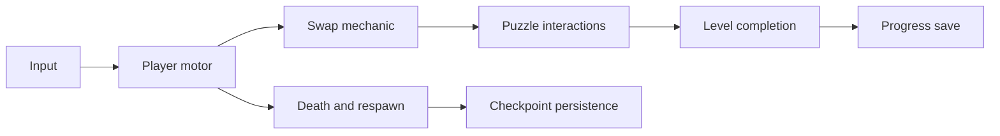
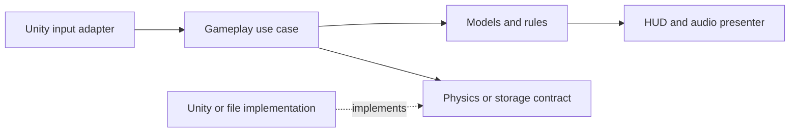
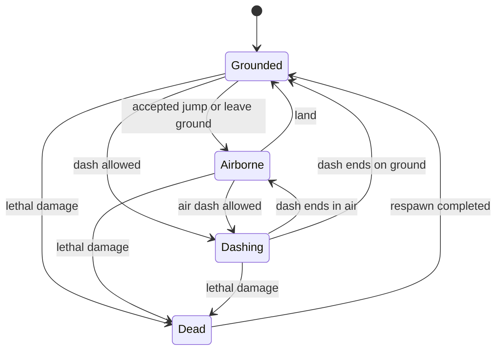

# Game Programming: From Beginner Unity Developer to Professional

**Audience:** You already know basic Unity and C#, and want to plan, build, maintain, and ship games confidently.

**Version context:** This repository uses Unity **6000.2.7f2**, Input System **1.14.2**, and Test Framework **1.6.0**. Engine examples target Unity 6.2. General architecture examples apply beyond Unity. Prepared on **8 October 2026**.

**Outcome:** Learn to turn an idea into a small finished game; design systems that can change safely; diagnose problems with evidence; and explain the tradeoffs behind your code.

This is a handbook, a reference, and a practice plan. It covers the common foundation and introduces advanced specializations. Becoming professional requires applying these ideas repeatedly in playable projects. You do not need every pattern in every game.

## Contents

1. [How to study and what professional competence means](#study)
2. [Plan a game before building it](#planning)
3. [Turn design into a production plan](#production)
4. [The complete development lifecycle](#lifecycle)
5. [C# foundations you need to strengthen](#csharp)
6. [Algorithms, data structures, and game mathematics](#fundamentals)
7. [Unity execution, timing, and object lifetimes](#unity)
8. [Project structure and code ownership](#structure)
9. [Architecture, composition, and SOLID](#architecture)
10. [A decision guide to programming patterns](#pattern-map)
11. [Finite, hierarchical, and pushdown state machines](#states)
12. [Observer, events, and event queues](#events)
13. [Strategy and interchangeable behavior](#strategy)
14. [Commands, undo, input recording, and replay](#commands)
15. [Factories, builders, prototypes, and dependency injection](#creation)
16. [Object pooling and safe reuse](#pooling)
17. [ScriptableObjects and data-driven design](#data)
18. [MVC, MVP, MVVM, and UI architecture](#ui)
19. [The remaining object-oriented patterns](#other-patterns)
20. [Game-specific patterns and performance architecture](#game-patterns)
21. [Input, movement, physics, and cameras](#movement)
22. [Combat, abilities, inventory, and progression](#gameplay)
23. [AI: FSMs, behavior trees, utility, GOAP, and navigation](#ai)
24. [Scenes, loading, pause, checkpoints, and respawn](#flow)
25. [Saves, settings, versioning, and persistence](#saving)
26. [Coroutines, async, cancellation, and scheduling](#async)
27. [Animation, audio, VFX, and game feel](#presentation)
28. [Procedural generation and reproducibility](#procedural)
29. [Networking and multiplayer foundations](#networking)
30. [Jobs, Burst, ECS, and data-oriented design](#dots)
31. [Debugging and diagnostics](#debugging)
32. [Testing and quality assurance](#testing)
33. [Profiling and optimization](#performance)
34. [Tools, collaboration, builds, and release](#shipping)
35. [A worked plan for ShadowSwap](#shadowswap)
36. [A staged learning roadmap and practice projects](#roadmap)
37. [Templates and coding checklists](#templates)
38. [Glossary and further reading](#glossary)

<a id="study"></a>
## 1. How to study and what professional competence means

Professional game programming combines **correctness, iteration speed, performance, collaboration, and delivery**. A clever implementation is valuable only if it solves the actual game problem.

You should eventually be able to:

- Convert a vague feature into clear rules and acceptance criteria.
- Identify who owns a piece of state and who may change it.
- Build a small working implementation, then improve it when evidence justifies improvement.
- Make changes without breaking unrelated systems.
- Explain object lifetimes, update order, dependencies, and failure behavior.
- Reproduce a bug, find its cause, and verify a fix.
- Measure CPU, GPU, memory, and loading costs on the target hardware.
- Use version control, review code, and produce repeatable builds.
- Finish games, including menus, saves, settings, accessibility, and release work.

### 1.1 Use three passes through this document

**Pass 1: Build a small game.** Read planning, lifecycle, C#, Unity timing, composition, FSMs, events, input, saves, debugging, and release. Use simple implementations.

**Pass 2: Improve a real project.** Refactor one painful subsystem at a time. Introduce patterns when you can name the problem they solve. Add meaningful tests around stable gameplay rules.

**Pass 3: Specialize.** Choose gameplay/AI, graphics, engine/performance, tools, or networking. Explore ECS, custom rendering, prediction, and larger architectures when your goals require them.

For each concept, follow this learning loop:

1. Explain it in your own words.
2. Build the smallest example without copying a tutorial.
3. Add a second use case that challenges the design.
4. Intentionally break it and inspect the failure.
5. Write down when you would use it and when you would avoid it.

### 1.2 How to use the code examples

Examples marked **complete example** include their imports and required types, except for explicitly referenced earlier examples or Unity's built-in types. Save Unity component classes in files matching their class names. Follow the setup instructions; Inspector references are part of the implementation.

Examples marked **sketch** or **pseudocode** illustrate structure and require your own surrounding classes. They are not a downloadable production framework. Do not paste every snippet into your current game at once; use a separate learning scene or practice project.

**Example verification:** The 12 complete C# blocks were compile-checked with C# 9, using installed Unity 6000.3 assemblies where engine references were required. The engine-independent health, FSM, damage strategies, and undo/redo examples passed 23 behavioral checks. Compilation was not a Unity 6.2 Play Mode or device test; verify Inspector setup, scene lifecycles, and gameplay integration in your learning project.

### 1.3 Keep an engineering notebook

After each feature, record:

| Question | Example answer |
|---|---|
| What was the player-facing goal? | Swapping should preserve momentum and feel predictable. |
| What rules did I choose? | Reject swaps into solid geometry; do not consume cooldown on rejection. |
| Who owns the data? | Player ability owns cooldown; motor owns velocity. |
| What failed? | A trigger callback changed position during physics processing. |
| What evidence fixed it? | Logging simulation steps showed a duplicate swap request. |
| What would I change next time? | Buffer requests and commit the swap once in a defined phase. |

<a id="planning"></a>
## 2. Plan a game before building it

Planning reduces uncertainty. Its purpose is to help you choose what to build next, rather than predict every detail before you have played a prototype.

### 2.1 Write a one-page concept

Answer these questions in ordinary language:

1. **Player fantasy:** What does the player feel capable of doing?
2. **Core mechanic:** What action makes the game distinctive?
3. **Core loop:** What does the player repeatedly do?
4. **Goal and failure:** How does the player win, lose, and recover?
5. **Audience and platform:** Who plays, on what device, and with what controls?
6. **Session length:** Is this a two-minute mobile level or a long desktop session?
7. **Scope:** How much content can you realistically finish?
8. **Constraints:** Time, team, hardware, budget, art, audio, localization, and online services.
9. **Success criteria:** What observable evidence would make the prototype worth continuing?

For ShadowSwap:

> A short 2D puzzle platformer where swapping with a mirrored shadow creates new routes through hazards. The player studies a room, moves and jumps, swaps to reach a safe position, collects an objective, and exits. Failure returns the player to a nearby checkpoint quickly.

### 2.2 Define design pillars

Choose three or four principles that guide decisions. Example:

- **Readable puzzles:** The player can understand where a swap will place them.
- **Predictable movement:** The same input under the same conditions behaves consistently.
- **Fast retries:** Failure costs little time.
- **One mechanic, many uses:** New levels deepen swapping rather than continually adding controls.

If a feature conflicts with these pillars, justify it or remove it.

### 2.3 Separate different kinds of loops

| Loop | Typical timescale | Example |
|---|---|---|
| Moment-to-moment | Fractions of a second to seconds | Move, jump, avoid a spike, swap. |
| Core gameplay | Minutes | Solve a room, collect an item, reach the exit. |
| Progression | Multiple sessions | Unlock levels, learn combinations, improve completion time. |
| Simulation/game loop | Every frame or tick | Read requests, simulate systems, present the result. |

The first three describe player experience. The last describes how software updates.

### 2.4 Write a small Game Design Document

Your GDD should describe **behavior and experience**:

- Movement, camera, controls, combat or interaction rules.
- Objects, enemies, hazards, collectibles, levels, and progression.
- UI screens and information the player needs.
- Audio and visual feedback.
- Accessibility and difficulty options.
- Content quantities and production constraints.

Use diagrams, tables, and measurable values. “Jump feels good” is a goal; “variable jump height, 0.1-second coyote time, immediate landing feedback” describes an initial implementation to evaluate.

### 2.5 Write a Technical Design Document

Your TDD should describe **how the software supports the design**:

- Engine version, render pipeline, packages, platforms, and build process.
- Major systems and dependency directions.
- Data ownership and authoring workflow.
- Scene and object lifetimes.
- Input and simulation timing.
- Save format, stable IDs, migrations, and recovery behavior.
- Performance targets and likely bottlenecks.
- Testing strategy, debug tools, and implementation risks.

Keep both documents short at first and update them after decisions change.

### 2.6 Scope aggressively

Classify features as **must have**, **should have**, **could have**, and **excluded for this release**. Define an MVP: the smallest complete experience that proves the core loop.

A manageable first professional practice project might have one playable character, one mechanic, three levels, a menu, settings, saves, and an ending. Treat multiplayer, procedural worlds, complex crafting, and live services as separate major projects.

Scope includes content and support work. Ten enemy types require design, code, art, animation, balancing, sound, tests, and integration. One reusable enemy with three data configurations may be a better choice.

### 2.7 Investigate risks before polishing

Create a risk register:

| Risk | Impact | Cheap experiment | Decision |
|---|---|---|---|
| Swapping is confusing | Players cannot solve puzzles | Graybox room with destination preview | Keep, redesign, or remove preview. |
| Movement feels unreliable | Core loop fails | Test jumps at different frame rates | Select movement approach. |
| Mobile controls obscure hazards | Levels become unfair | Build to a real device | Change layout and input. |
| Save format cannot handle updates | Progress can be lost | Load an older save fixture | Add versioned migration. |

Build a prototype for the riskiest assumption before investing in a large architecture.

<a id="production"></a>
## 3. Turn design into a production plan

### 3.1 Build a feature dependency map

An example dependency chain:



This is an implementation dependency map, not necessarily the runtime dependency graph. Build the foundations before their dependent features.

### 3.2 Break features into reviewable work

Weak task: “Make player system.”

Better tasks:

- Read Move and Jump actions through an input adapter.
- Move horizontally using one motor that owns Rigidbody2D writes.
- Detect grounding using a specified collision mask.
- Add jump buffering and coyote time.
- Verify landing and jumping near platform edges.
- Expose movement tuning in authoring data.
- Add a small movement test scene.

Each task should leave the game in a playable or inspectable state.

### 3.3 Define acceptance criteria before coding

For a swap ability:

- A valid request swaps the two positions once.
- A blocked destination leaves positions and cooldown unchanged.
- Velocity is preserved, reset, or mirrored according to an explicit rule.
- Input while paused or dead produces no swap.
- Multiple requests before a simulation step follow a defined policy.
- The preview agrees with the destination used by the actual swap.
- Feedback communicates success and rejection.

These criteria become your implementation checklist and test cases.

### 3.4 Estimate uncertainty as well as effort

Separate coding, content, integration, verification, and polish. Use ranges when a problem is unfamiliar. Include time for discovery and fixing regressions. Keep a playable build at the end of each milestone.

If a task keeps expanding, split it or reduce its scope. A milestone should have an observable exit condition rather than only a calendar date.

### 3.5 Definition of done

A feature is done when it works through the intended player flow, handles agreed edge cases, has usable feedback, is verified in a build where relevant, and has enough documentation for future changes. A script compiling is only one step.

<a id="lifecycle"></a>
## 4. The complete development lifecycle

| Stage | Main question | Deliverable | Exit condition |
|---|---|---|---|
| Discovery | What experience are we trying to create? | Concept, constraints, risk register | Core idea and boundaries are clear. |
| Prototype | Is the core mechanic enjoyable and understandable? | Disposable graybox build | Playtesting supports continuing. |
| Preproduction | Can we build this with our resources? | TDD, pipeline, backlog | Major technical/content risks are understood. |
| Vertical slice | Can all systems work together at target quality? | One representative finished segment | Gameplay, UI, art, audio, saves, and build integrate. |
| Production | Can we create the planned content efficiently? | Regular playable builds | Planned features/content are implemented. |
| Alpha | Can the entire game be played end to end? | Complete game flow | No missing essential systems. |
| Beta | Is it stable and usable on supported hardware? | Focused bug fixes and tuning | Quality and performance targets are met. |
| Release candidate | Is this exact build ready to ship? | Versioned, verified artifact | Release checklist passes. |
| Post-release | What should be repaired or improved? | Patches and prioritized feedback | Changes preserve player data and existing behavior. |

Teams use these labels differently. Agree on your own exit criteria.

### 4.1 Prototype code and production code

In a prototype, speed of learning matters. Hard-coded values and a compact controller can be appropriate. Record which shortcuts you took.

After the mechanic is proven, make deliberate decisions about validation, lifetimes, tests, data, and interfaces. Rewriting every working line is rarely necessary. Refactor around demonstrated pain and the requirements of production.

### 4.2 Build vertically

A vertical feature includes input, rules, presentation, and verification. For example: a collectible appears in a room, the player acquires it, the HUD updates, the objective unlocks the exit, progress survives reload, and duplicate pickup is prevented.

Completing one integrated feature reveals architecture problems sooner than writing every manager before any gameplay works.

<a id="csharp"></a>
## 5. C# foundations you need to strengthen

### 5.1 Language concepts and their game uses

| Concept | Meaning | Game use or common mistake |
|---|---|---|
| Class | Reference type with identity | Inventory or session model; multiple references can point to the same object. |
| Struct | Value type copied by value | Small coordinates or request data; mutable structs can produce surprising copies. |
| Interface | Contract describing capabilities | `IDamageable`, `ISaveStore`, `IClock`. |
| Abstract class | Shared base implementation with extension points | A small stable family of behavior; avoid deep hierarchies. |
| Encapsulation | Control how state changes | Private health value modified through validated methods. |
| Polymorphism | Use multiple implementations through one contract | Different targeting strategies through `ITargetingStrategy`. |
| Generic | Type parameterized code | `List<Item>`, `Queue<Command>`, `ObjectPool<Projectile>`. |
| Delegate | Reference to compatible callable behavior | Callback when an operation finishes. |
| Event | Publisher-controlled notification subscription | Health changes notify HUD and audio. |
| Lambda | Inline function expression | Small callbacks; captured variables can create allocations and lifetime coupling. |
| Property | Controlled access to data | Public read-only current health. |
| Enum | Named finite choices | Difficulty or a compact state machine. |
| Attribute | Metadata used by tools/runtime | `[SerializeField]`, `[Serializable]`, `[Min]`. |
| Exception | Failure propagated through call stack | Invalid configuration or unexpected I/O failure; avoid exceptions for ordinary blocked actions. |
| Pattern matching | Branching on type/shape/value | Handling a small set of result types clearly. |
| Iterator | Sequence generated over time | `IEnumerator` coroutine or lazy enumeration. |
| Extension method | Static helper invoked like an instance method | Focused conveniences; do not hide essential behavior. |
| Nullable reference analysis | Compiler assistance for missing references | Helpful when supported/configured; Inspector wiring still needs validation. |
| `readonly` / `const` | Limits reassignment / compile-time constant | Stable references and constants; a readonly reference can still point to a mutable object. |
| `IDisposable` | Explicit cleanup contract | Release streams, subscriptions, or native resources you own. |

Practice these in a small plain C# project as well as Unity. Engine callbacks can hide gaps in your understanding of ordinary objects and constructors.

### 5.2 Separate reference assignment from data copying

**Sketch:**

```csharp
Inventory first = new Inventory();
Inventory second = first; // Both variables refer to the same inventory.

Vector2 a = new Vector2(1, 2);
Vector2 b = a;            // b receives a value copy.
b.x = 99;                // a.x remains 1.
```

A struct containing a reference still shares the referenced object when copied. Value types are not automatically deeply immutable.

### 5.3 Understand memory without memorizing myths

Managed objects are reclaimed by garbage collection when no longer reachable. Allocations can come from strings, closures, boxing, collection growth, iterators, and other operations.

“Classes always on heap, structs always on stack” is too simplistic. Structs can be fields inside heap objects, stored in arrays, or boxed. Think about identity, copying, ownership, and measured allocation behavior.

Managed collection is different from releasing Unity objects or native memory. A `GameObject` normally needs `Destroy` when you own its lifetime; a native collection needs its documented disposal procedure.

### 5.4 Write APIs that protect invariants

An **invariant** is a condition that must remain true, such as `0 <= CurrentHealth <= MaxHealth` or “an item belongs to at most one inventory slot.”

Prefer `TrySpend(amount)` over making a currency field public. Validate requests once at the authority that owns the value. Return a meaningful result for ordinary failure.

### 5.5 Complete example: an engine-independent health model

Save as `Health.cs` in a learning project. It depends only on .NET. Event arguments contain a snapshot, so observers need not read mutable state later.

```csharp
using System;

namespace LearningGame.Domain
{
    public sealed class Health
    {
        public int Maximum { get; }
        public int Current { get; private set; }
        public bool IsDead => Current == 0;

        public event Action<int, int> Changed;
        public event Action Died;

        public Health(int maximum)
        {
            if (maximum <= 0)
                throw new ArgumentOutOfRangeException(nameof(maximum));

            Maximum = maximum;
            Current = maximum;
        }

        public bool TryDamage(int amount)
        {
            if (amount <= 0 || IsDead)
                return false;

            int next = amount >= Current ? 0 : Current - amount;
            Current = next;
            bool diedNow = next == 0;

            Changed?.Invoke(next, Maximum);
            if (diedNow)
                Died?.Invoke();

            return true;
        }

        public bool TryHeal(int amount)
        {
            if (amount <= 0 || IsDead || Current == Maximum)
                return false;

            int missing = Maximum - Current;
            Current += amount >= missing ? missing : amount;
            Changed?.Invoke(Current, Maximum);
            return true;
        }
    }
}
```

Rules are explicit: dead entities cannot heal; damage below one is rejected; repeated lethal hits cannot emit repeated death notifications. Respawn can create a fresh model or use a separately specified reset operation.

This example assumes observers are nonthrowing and do not mutate this same model during notification. Direct C# event invocation runs listeners synchronously; a throwing listener interrupts later callbacks. Larger systems may publish queued snapshots after completing authoritative work.

### 5.6 Common C# habits to improve

- Use descriptive names and explicit units: `speedUnitsPerSecond`, `cooldownSeconds`.
- Keep mutable fields private; expose only what callers need.
- Avoid magic strings for IDs and Animator parameters when a centralized definition works.
- Avoid using exceptions as the normal “cannot jump” or “not enough money” path.
- Learn debugger breakpoints, watches, call stacks, and conditional breakpoints.
- Understand collection invalidation: removing from a list during `foreach` usually fails.
- Learn `try/finally` and `using` for reliable cleanup.
- Prefer a simple loop when LINQ obscures a critical hot path; measure allocations rather than banning LINQ everywhere.
- Check Unity's supported language/runtime features before copying code from a newer .NET tutorial.

<a id="fundamentals"></a>
## 6. Algorithms, data structures, and game mathematics

### 6.1 Choose structures by operation

| Structure | Strength | Example | Caution |
|---|---|---|---|
| Array | Fixed size, indexed access, predictable storage | Board cells, fixed sample buffers | Resizing requires replacement/copying. |
| `List<T>` | Indexed dynamic sequence | Active enemies | Removing the middle shifts elements; capacity growth can allocate. |
| `Dictionary<K,V>` | Expected fast lookup by key | Item definitions by ID | Not an ordered list; validate duplicate keys. |
| `HashSet<T>` | Unique membership | Already-hit targets | Mutable hash keys can break lookup. |
| `Queue<T>` | First in, first out | Pending gameplay requests | Bound backlog and define overflow behavior. |
| `Stack<T>` | Last in, first out | Undo history, nested screens | Define ownership of stored entries. |
| Heap/priority queue | Retrieve best-priority entry efficiently | A* open set, scheduled work | API availability varies with runtime; ties need policy. |
| Grid/spatial hash | Nearby-object lookup | Enemy perception, broad-phase queries | Cell size and boundary cases matter. |
| Tree/graph | Hierarchical or connected structure | UI tree, navigation graph | Cycles and recursion depth need attention. |

### 6.2 Understand complexity

- **O(1):** Work does not grow with collection size, for example indexed array access.
- **O(n):** One scan through all entries.
- **O(n log n):** Common comparison sorting cost.
- **O(n²):** Every object compared with every other object.

Expected O(1) dictionary lookup is not a guaranteed worst-case bound. Complexity helps predict scaling; actual performance also depends on cache behavior, allocations, engine calls, and constants.

If 1,000 enemies each scan 1,000 possible targets, you may create roughly one million comparisons per perception update. Reduce candidate sets, lower update frequency, or use spatial queries before inventing a complicated optimization.

### 6.3 Essential mathematics

| Topic | What to learn | Use |
|---|---|---|
| Vectors | Addition, normalization, magnitude | Movement and directions. |
| Dot product | Alignment/projection | Is a target in front? How steep is a surface? |
| Cross product | Perpendicular orientation | 3D axes and orientation. |
| Trigonometry | Angles, sine/cosine, radians | Arcs, circles, aim directions. |
| Quaternions | Rotation representation/composition | Stable 3D rotation without treating Euler angles as ordinary vectors. |
| Coordinate spaces | Local, world, view, screen | Parent-relative movement and cursor targeting. |
| Interpolation | Lerp, slerp, smoothing | Animation and presentation between states. |
| Calculus intuition | Position, velocity, acceleration | Movement integration. |
| Probability | Weighted choices and distributions | Loot, procedural variation, AI selection. |
| Geometry | Bounds, rays, intersections | Ground tests, visibility, collision validation. |

Position integration: `position += velocity * dt`. Velocity integration: `velocity += acceleration * dt`. Velocity assigned to a Rigidbody is already a per-second quantity; do not multiply it by `dt` again.

Repeated `Lerp(current, target, speed * dt)` creates a smoothing response, not constant-speed travel or a guaranteed duration. Use `MoveTowards` for a fixed speed. For approximately frame-rate-independent exponential smoothing, use `1 - exp(-sharpness * dt)` as the interpolation factor.

### 6.4 Determinism and numerical tolerance

Determinism means the same initial state and same inputs produce the same results under the intended execution conditions. Floating-point math, physics, thread order, and random calls can complicate it.

Use tolerances for approximate numeric comparisons where appropriate. Do not assume a fixed timestep alone makes Unity physics deterministic across platforms. For replays or networking, decide whether you need exact deterministic simulation or can record authoritative state corrections.

<a id="unity"></a>
## 7. Unity execution, timing, and object lifetimes

### 7.1 Understand the player loop

Typical roles: `Awake` initializes local references; `OnEnable` activates participation; `Start` performs initialization before the first update when enabled; `Update` handles frame logic; `FixedUpdate` handles fixed-step logic; `LateUpdate` handles follow-up presentation. Cleanup commonly belongs in `OnDisable` and `OnDestroy`, depending on ownership. Callback ordering between different objects is limited; do not assume another component's `Awake` has run just because yours is running. See [Unity event execution order](https://docs.unity3d.com/6000.0/Documentation/Manual/execution-order.html).

Use explicit initialization for dependencies that require ordering. A bootstrapper can create models, initialize adapters, bind views, and then enable gameplay. Script execution order can help selected engine integrations, but cannot repair unclear ownership.

### 7.2 Distinguish clocks

| Clock | Use |
|---|---|
| Scaled frame time | Gameplay timers affected by pause/slow motion. |
| Unscaled frame time | Pause menus and transitions that continue while gameplay pauses. |
| Fixed simulation time | Physics-aligned cooldowns and movement decisions. |
| Real/wall-clock time | External expiry and timestamps; system-clock changes need consideration. |
| Injected test clock | Repeatable rule tests without waiting in real time. |

A render frame can have zero, one, or multiple fixed steps. Choose which clock owns a timer and use it consistently.

### 7.3 Lifetime categories

- **Application:** Settings, persistent save service, platform integration.
- **Session/run:** Current score, run inventory, difficulty modifiers.
- **Scene/level:** Puzzle state, level enemies, checkpoint set.
- **Entity:** Health, motor, ability runtime state.
- **Pooled activation:** One projectile flight or particle burst.

Long-lived objects must release references to shorter-lived objects after unload or despawn. A static event retaining a scene component can keep data reachable and invoke destroyed listeners.

### 7.4 Unity object identity and null

Unity objects wrap native engine objects and have special equality behavior. A destroyed Unity object may compare equal to `null` even when a managed wrapper still exists. Plain C# objects do not behave this way. Do not assume `?.` or `??` performs Unity's destroyed-object validity check. See [Unity Object API](https://docs.unity3d.com/6000.2/Documentation/ScriptReference/Object.html).

Do not construct a `MonoBehaviour` with `new`. Create or reference components through Unity. Construct plain C# models with ordinary constructors.

### 7.5 Authoring validation

Validate required serialized references and numeric ranges. Use Inspector attributes for authoring convenience and runtime checks for actual guarantees. `OnValidate` should remain focused on safe validation; it is an editor callback and can occur outside assumptions you make about runtime initialization. See [Unity OnValidate limitations](https://docs.unity3d.com/6000.2/Documentation/ScriptReference/MonoBehaviour.OnValidate.html).

Learn the difference between prefab assets, prefab instances, overrides, scene objects, and runtime-created objects. Changes to a runtime instance do not automatically create persistent saved data.

### 7.6 Enter Play Mode settings

If domain reload is disabled, static data and subscriptions can persist between play sessions unless explicitly reset. Verify bootstrap behavior under the project's settings. Initialization must also work when loading a level directly during development. See [Unity domain reload](https://docs.unity3d.com/6000.2/Documentation/Manual/domain-reloading.html).

<a id="structure"></a>
## 8. Project structure and code ownership

### 8.1 A practical starting structure

This is a proposed structure for learning and future organization, not an instruction to move the current project's files immediately.

```text
Assets/
  Game/
    Runtime/
      Core/                 # Small shared contracts and infrastructure
      Gameplay/
        Player/
        Combat/
        Inventory/
        Puzzles/
        AI/
      Presentation/
        UI/
        Audio/
        VFX/
      Infrastructure/
        Saving/
        Scenes/
        Platform/
    Editor/                 # Editor-only tools
    Tests/
      EditMode/
      PlayMode/
    Data/                   # ScriptableObject authoring assets
    Prefabs/
    Scenes/
    Art/
    Audio/
  ThirdParty/
Docs/
```

Organize by feature when features evolve together. Keep shared code small and meaningful; `Core` should not become a dumping ground. Use namespaces such as `ShadowSwap.Gameplay.Player`.

### 8.2 Assembly definitions

Assembly definitions create explicit compilation/dependency boundaries. They can help separate runtime, editor tools, tests, and independent systems. Avoid circular references and excessive tiny assemblies. A plain C# domain assembly can restrict engine dependencies. See [Unity assembly definitions](https://docs.unity3d.com/6000.2/Documentation/Manual/assembly-definition-files.html).

An asmdef assembly cannot simply depend on types left in the predefined `Assembly-CSharp` assembly. Move dependencies into appropriate named assemblies when introducing these boundaries.

### 8.3 Name ownership, not just “managers”

`LevelLoader`, `SaveStore`, `PlayerMotor`, `RunSession`, and `AudioPresenter` communicate narrower responsibilities than `GameManager` with dozens of unrelated fields.

One small coordinator can be reasonable. It becomes a problem when it owns input, combat, UI, inventory, saves, spawning, and audio simultaneously.

### 8.4 Write an ownership table

| Data | Sole authority | Readers | Lifetime |
|---|---|---|---|
| Player velocity | Player motor | Animator, camera, ability validation | Entity |
| Current health | Health model | HUD, death coordinator | Entity |
| Swap cooldown | Swap ability | HUD and input feedback | Entity/run |
| Current objective | Level objective model | Exit door, HUD | Level |
| Unlocked levels | Progress model/save service | Level select | Application |

Multiple systems can request changes, but one authority should commit them.

<a id="architecture"></a>
## 9. Architecture, composition, and SOLID

### 9.1 Use three conceptual layers

**Domain/rules:** Health, inventory rules, objective completion, cooldown decisions. Keep these engine-independent where useful.

**Application/use cases:** Execute a swap, start a run, complete a level, save progress. Coordinates rules without owning every low-level detail.

**Adapters/infrastructure/presentation:** Unity input, physics, scene loading, storage, HUD, audio, animation, and platform services.



This is a useful dependency direction, not a requirement to build a large enterprise framework. A tiny game can implement it with a few components and plain objects.

### 9.2 Prefer composition for changing capabilities

Inheritance asks “is this a specialized kind of that?” Composition asks “what capabilities does this entity have?”

A player can have a motor, health, inventory, and swap ability. An enemy can reuse health without inheriting from a giant player/enemy superclass. Add flying movement through a movement capability rather than building `FlyingArmoredRangedEnemyWithLoot`.

Use inheritance for a small stable relationship. Use composition for independently varying behaviors.

### 9.3 SOLID in game terms

| Principle | Practical interpretation | Example | Overuse to avoid |
|---|---|---|---|
| Single responsibility | Keep changes for one concern together | Health rules separate from health bar | Splitting every two-line operation into a class. |
| Open/closed | Add a variant through a stable extension point | Add a new targeting strategy | Designing extension points for imaginary requirements. |
| Liskov substitution | Implementations honor the caller's expectations | All `ISaveStore` implementations obey documented load results | Subtype silently throws for a promised operation. |
| Interface segregation | Give callers only the capabilities they need | `IDamageable` separate from `IMovable` | A universal entity interface with fifty methods. |
| Dependency inversion | Stable policy depends on contracts, not volatile details | Progress saving depends on a save-store contract | An interface for every private implementation detail. |

### 9.4 Other principles

- **KISS:** Choose the simplest design that handles current requirements clearly.
- **YAGNI:** Avoid building a system merely because you might need it someday.
- **DRY:** Keep one authoritative expression of the same rule; do not merge code that only happens to look similar.
- **Cohesion:** A module's parts should serve a related purpose.
- **Coupling:** Understand what must change together and why.
- **Tell, don't ask:** Prefer requesting a domain operation over extracting fields and reconstructing its rules elsewhere.
- **Law of Demeter:** Avoid reaching through chains of objects to manipulate distant internals.

### 9.5 Practical feature workflow

For each feature: state the rule, identify the owner, decide dependencies, write the smallest implementation, integrate presentation, verify edge cases, then refactor demonstrated duplication or coupling.

Before adding a pattern, answer: **What concrete change becomes easier? What new complexity am I accepting?**

<a id="pattern-map"></a>
## 10. A decision guide to programming patterns

A pattern is a named approach to a recurring design problem. It is not a mandatory framework. Several patterns often work together: an input adapter creates a command; an ability uses a strategy; a factory creates a projectile; a pool reuses it; an event updates the HUD.

### 10.1 Learn these first

| Problem you actually have | Candidate approach | Start with |
|---|---|---|
| Different behavior in idle, jumping, and dead modes | State machine | Enum and explicit transitions. |
| UI/audio should react without being called by gameplay rules | Observer | Typed C# events with controlled lifetimes. |
| Several interchangeable targeting or damage behaviors | Strategy | A small interface or delegate. |
| Object construction is repeated and inconsistent | Factory | One creation method that validates setup. |
| Many short-lived objects create measurable overhead | Object pool | Pool one proven high-churn object type. |
| Designers need reusable tuning data | Data-driven configuration | ScriptableObject definitions and separate runtime state. |
| Rules are hard to test because they reach into scene objects | Dependency injection | Constructor injection for plain C# objects. |
| UI contains gameplay rules and changes constantly | MVP | Model, view, and presenter with explicit binding. |
| Actions need queuing, recording, or undo | Command | A request object plus explicit execution. |

### 10.2 Keep a pattern decision record

Write: problem, alternatives, chosen solution, benefits, costs, and when to revisit. Example: “Use a local health event because two views react independently. Avoid a global event bus until cross-system communication requires one.”

Unity provides practical official examples in its [design patterns course](https://learn.unity.com/course/design-patterns). Use the samples as learning references, then adapt ownership and lifetime rules to your game.

<a id="states"></a>
## 11. Finite, hierarchical, and pushdown state machines

### 11.1 What a finite state machine is

An FSM has a finite set of modes, one active mode within a region, and defined transitions. A transition has a trigger, an optional guard, and often an effect.

Example character states: Grounded, Airborne, Dashing, Stunned, Dead.



Important terms:

- **State:** A mode with behavior and rules.
- **Transition:** A change from one state to another.
- **Trigger:** Input, collision, timer, event, or condition requesting change.
- **Guard:** Condition that must be true, such as enough energy.
- **Entry action:** Work performed once on entering a state.
- **Exit action:** Cleanup performed once on leaving.
- **Tick:** Regular state update.
- **Context:** Data and capabilities shared with state implementations.
- **Priority:** Which transition wins when several are possible.

An FSM replaces invalid combinations such as `isDead && isAttacking && isDashing`. It does not eliminate all flags: orthogonal facts such as “has key” are still data.

### 11.2 Begin with an enum when the behavior is small

**Sketch:**

```csharp
switch (state)
{
    case PlayerState.Grounded:
        UpdateGrounded();
        if (jumpRequested && CanJump())
            ChangeState(PlayerState.Airborne);
        break;

    case PlayerState.Airborne:
        UpdateAirborne();
        if (IsGrounded() && verticalVelocity <= 0)
            ChangeState(PlayerState.Grounded);
        break;

    case PlayerState.Dead:
        break;
}
```

Keep all transitions in one function so entry and exit work cannot be skipped. Move to separate state classes when each state's behavior or dependencies becomes difficult to manage.

### 11.3 Complete example: a small deferred-transition FSM

Save as `StateMachine.cs`. This plain C# example has a deliberate policy:

- Request transitions during gameplay ticks or external input handling.
- Apply a pending transition at the **beginning of the next `Tick`**.
- The first valid pending request wins; later requests return false.
- `Enter` and `Exit` may not request transitions.
- `FixedTick` updates the current state but does not commit transitions.
- State instances are reused, so `Enter` resets any state-specific timers.

This deferred policy avoids changing state in the middle of an active callback. If death must override every other request, add explicit priority arbitration rather than relying on callback order.

```csharp
using System;

namespace LearningGame.States
{
    public interface IGameState
    {
        void Enter();
        void Tick(float deltaTime);
        void FixedTick(float fixedDeltaTime);
        void Exit();
    }

    public sealed class StateMachine
    {
        public IGameState Current { get; private set; }

        private IGameState pending;
        private bool inLifecycleCallback;

        public StateMachine(IGameState initial)
        {
            Current = initial ?? throw new ArgumentNullException(nameof(initial));
            RunLifecycle(Current.Enter);
        }

        public bool RequestState(IGameState next)
        {
            if (next == null)
                throw new ArgumentNullException(nameof(next));
            if (inLifecycleCallback)
                throw new InvalidOperationException("Do not transition in Enter/Exit.");
            if (Current == null || ReferenceEquals(Current, next) || pending != null)
                return false;

            pending = next;
            return true;
        }

        public void Tick(float deltaTime)
        {
            if (pending != null)
            {
                IGameState next = pending;
                pending = null;
                RunLifecycle(Current.Exit);
                Current = next;
                RunLifecycle(Current.Enter);
            }

            Current?.Tick(deltaTime);
        }

        public void FixedTick(float fixedDeltaTime)
        {
            Current?.FixedTick(fixedDeltaTime);
        }

        public void Stop()
        {
            pending = null;
            if (Current == null)
                return;

            RunLifecycle(Current.Exit);
            Current = null;
        }

        private void RunLifecycle(Action callback)
        {
            inLifecycleCallback = true;
            try { callback(); }
            finally { inLifecycleCallback = false; }
        }
    }
}
```

Callbacks should be short and nonthrowing during ordinary gameplay. This educational machine is single-threaded and does not provide hierarchical states, serialization, or recovery from failing callbacks. Those features should be added only if your game requires them.

### 11.4 Complete example: host it in Unity

Save as `StateMachineDemo.cs` alongside the preceding example. Attach it to a GameObject, enter Play Mode, and use the component's context-menu action to request a countdown. Disabling the component stops the machine; enabling it creates a new one.

```csharp
using LearningGame.States;
using UnityEngine;

public sealed class StateMachineDemo : MonoBehaviour
{
    private StateMachine machine;
    private CountdownState countdown;

    private void OnEnable()
    {
        var idle = new IdleState();
        machine = new StateMachine(idle);
        countdown = new CountdownState(machine, idle, 2f);
    }

    [ContextMenu("Begin Countdown")]
    public void BeginCountdown()
    {
        if (Application.isPlaying && machine != null)
            machine.RequestState(countdown);
    }

    private void Update() => machine?.Tick(Time.deltaTime);
    private void FixedUpdate() => machine?.FixedTick(Time.fixedDeltaTime);

    private void OnDisable()
    {
        machine?.Stop();
        machine = null;
        countdown = null;
    }

    private sealed class IdleState : IGameState
    {
        public void Enter() => Debug.Log("Idle entered");
        public void Tick(float dt) { }
        public void FixedTick(float dt) { }
        public void Exit() { }
    }

    private sealed class CountdownState : IGameState
    {
        private readonly StateMachine owner;
        private readonly IGameState returnState;
        private readonly float duration;
        private float remaining;

        public CountdownState(StateMachine owner, IGameState returnState, float duration)
        {
            this.owner = owner;
            this.returnState = returnState;
            this.duration = duration;
        }

        public void Enter() => remaining = duration;
        public void Tick(float dt)
        {
            remaining -= dt;
            if (remaining <= 0f)
                owner.RequestState(returnState);
        }
        public void FixedTick(float dt) { }
        public void Exit() => Debug.Log("Countdown exited");
    }
}
```

### 11.5 Hierarchical state machines

An HFSM gives states parents. `Alive` can contain Grounded, Airborne, and Dashing, with a shared transition to Dead. Grounded can contain Idle and Running. Shared parent behavior reduces duplicated checks.

Define the order of exit and entry: exit active child before parent; enter parent before its child. Decide whether parent or child evaluates transitions first. Do not allow both to commit incompatible transitions in one tick.

### 11.6 Pushdown state machines

A pushdown machine uses a stack of states. Pause or inventory can be pushed above gameplay, then popped to return to the previous state.

Define whether covered states continue ticking, whether they still render, and whether input is blocked. A menu stack is often simpler than stacking the entire character simulation.

### 11.7 Orthogonal state regions

Locomotion and equipment may vary independently. Avoid creating every combination: RunningWithSword, RunningWithBow, JumpingWithSword, and so on.

Use separate regions or systems with clear coordination rules. For example, locomotion owns movement while combat requests a movement lock. Define which locks win and when they expire.

### 11.8 State machine mistakes

- Every script writes the state independently.
- `Enter` starts a coroutine that survives `Exit`.
- Reused states retain old timers or targets.
- Death, attack, and dash transitions race without priorities.
- The Animator becomes the only authority for gameplay rules.
- States directly manipulate unrelated UI or saving systems.
- Transition checks allocate new state objects every frame without need.

**Practice:** Build an enemy with Patrol, Investigate, Chase, Attack, Stunned, and Dead. Specify transition priority, losing a target, and target destruction. Add an on-screen state label and transition log.

<a id="events"></a>
## 12. Observer, events, and event queues

### 12.1 Observer in game programming

One publisher announces a change; interested listeners react. Health does not need to know about HUD, hit audio, achievements, or damage numbers.

Use a **direct method call** when you need a specific operation/result from a known collaborator. Use an **event** when a fact has occurred and zero or more listeners may respond.

`TryApplyDamage` is a request. `HealthChanged` is a fact. Do not turn a required dependency into an event just to avoid wiring a reference.

### 12.2 Complete example: bind a health model to a HUD

Save as `HealthHudExample.cs`. It uses `Health` from section 5 and a Unity UI `Slider`. Attach it to a GameObject and assign the slider. The Inspector context-menu damage action demonstrates notification. In a real game, inject the player's existing model rather than creating a separate HUD-owned health model.

```csharp
using LearningGame.Domain;
using UnityEngine;
using UnityEngine.UI;

public sealed class HealthHudExample : MonoBehaviour
{
    [SerializeField] private Slider slider;
    private Health health;

    private void Awake()
    {
        if (slider == null)
        {
            Debug.LogError("Assign a Slider.", this);
            enabled = false;
            return;
        }

        health = new Health(100);
    }

    private void OnEnable()
    {
        if (health == null)
            return;

        health.Changed += Render;
        Render(health.Current, health.Maximum);
    }

    private void OnDisable()
    {
        if (health != null)
            health.Changed -= Render;
    }

    [ContextMenu("Apply 10 Damage")]
    private void ApplyDamage()
    {
        if (Application.isPlaying)
            health?.TryDamage(10);
    }

    private void Render(int current, int maximum)
    {
        slider.minValue = 0;
        slider.maxValue = maximum;
        slider.SetValueWithoutNotify(current);
    }
}
```

Subscribe and unsubscribe in matching lifetime boundaries. For an active-only view, `OnEnable`/`OnDisable` is appropriate. For a plain object, explicit binding/unbinding or `IDisposable` may be clearer. See [Microsoft's C# event pattern guidance](https://learn.microsoft.com/en-us/dotnet/csharp/event-pattern).

### 12.3 Choose the event mechanism deliberately

| Mechanism | Useful for | Cost or risk |
|---|---|---|
| Typed C# event | Runtime code with discoverable contracts | Manual lifetime management and synchronous invocation. |
| `UnityEvent` | Inspector-authored designer connections | More indirect references and configuration that must be verified. |
| ScriptableObject event channel | Asset-based cross-scene authoring | Shared lifetime and hidden dependencies if overused. |
| Local message bus | Scoped communication between many participants | Harder tracing; contracts and scope are essential. |
| Queued events | Delayed processing at a known phase | Ordering, backlog, stale payloads, and latency. |

### 12.4 Event queues

An event queue stores immutable facts for later delivery. It can keep simulation changes separate from presentation, or avoid mutation during collection iteration.

Define:

- Producer and consumer phases.
- FIFO or priority ordering.
- Whether events generated during delivery run now or next tick.
- Maximum queue size and overflow behavior.
- Whether payloads use IDs or object references.
- What happens when a referenced entity has despawned.
- Whether multiple equivalent events can be coalesced.

Do not expect an immediate response from a queued notification. Required validation belongs in the direct authoritative operation.

**Practice:** Emit `SwapSucceeded` containing old/new positions and a player ID. Let audio and VFX react. Disable and re-enable the view repeatedly and verify that reactions do not multiply.

<a id="strategy"></a>
## 13. Strategy and interchangeable behavior

Strategy puts a varying algorithm behind a stable contract. Examples: targeting, damage formulas, steering, loot selection, difficulty policy, or aim assistance.

### 13.1 Complete example: replace a damage calculation

Save as `DamageStrategies.cs`. Values here are nonnegative integers. The subtraction check avoids overflowing a negative intermediate result.

```csharp
using System;

namespace LearningGame.Combat
{
    public interface IDamagePolicy
    {
        int Calculate(int baseDamage, int armor);
    }

    public sealed class FlatArmorPolicy : IDamagePolicy
    {
        public int Calculate(int baseDamage, int armor)
        {
            Validate(baseDamage, armor);
            return armor >= baseDamage ? 0 : baseDamage - armor;
        }

        private static void Validate(int damage, int armor)
        {
            if (damage < 0 || armor < 0)
                throw new ArgumentOutOfRangeException("Damage and armor must be nonnegative.");
        }
    }

    public sealed class IgnoreArmorPolicy : IDamagePolicy
    {
        public int Calculate(int baseDamage, int armor)
        {
            if (baseDamage < 0 || armor < 0)
                throw new ArgumentOutOfRangeException("Damage and armor must be nonnegative.");
            return baseDamage;
        }
    }
}
```

A weapon or combat service receives an `IDamagePolicy`. It can use a different policy without duplicating attack timing or projectile logic.

### 13.2 Strategy versus State

A strategy changes **how an operation is performed**. A state changes **which behavior is appropriate in the current mode**, usually including transitions and lifecycle actions.

Use a delegate for a small one-method algorithm when named classes add little value. Avoid interfaces for every arithmetic operation.

**Practice:** Implement nearest-target and lowest-health targeting policies. Keep detection/candidate collection separate from choosing among candidates.

<a id="commands"></a>
## 14. Commands, undo, input recording, and replay

### 14.1 Represent an intention as data

A command represents an operation to execute: Jump, Swap, UseItem, MoveUnit, PlaceBuilding. It can be queued, recorded, validated, or sent over a network.

Distinguish a request from a successful outcome. `SwapRequest` can fail validation; `SwapSucceeded` records what actually happened.

### 14.2 Complete example: undo in a pure grid game

Save as `MoveCellCommand.cs`. This example is for a local turn-based model without concurrent writers. It deliberately does not claim to undo real-time physics.

```csharp
using System;

namespace LearningGame.Commands
{
    public sealed class GridActor
    {
        public int Cell { get; private set; }
        public void SetCell(int cell) => Cell = cell;
    }

    public interface IUndoableCommand
    {
        void Execute();
        void Undo();
    }

    public sealed class MoveCellCommand : IUndoableCommand
    {
        private readonly GridActor actor;
        private readonly int destination;
        private int previous;
        private bool executed;

        public MoveCellCommand(GridActor actor, int destination)
        {
            this.actor = actor ?? throw new ArgumentNullException(nameof(actor));
            this.destination = destination;
        }

        public void Execute()
        {
            if (executed)
                throw new InvalidOperationException("Already executed.");
            previous = actor.Cell;
            actor.SetCell(destination);
            executed = true;
        }

        public void Undo()
        {
            if (!executed)
                throw new InvalidOperationException("Execute before undo.");
            actor.SetCell(previous);
            executed = false;
        }
    }
}
```

An undo stack must reverse commands in the correct order. Redo behavior and history invalidation need explicit policies. Inventory transactions or puzzle moves also need to record all affected values, not only a position.

### 14.3 Recording and replay

Record commands with simulation tick numbers and stable entity IDs. Record initial state, random seeds, and relevant version information.

Replaying inputs reliably requires sufficiently deterministic simulation. For physics-heavy gameplay, record periodic snapshots or authoritative outcomes to detect/correct divergence. Do not assume reproducing button presses automatically reproduces every collision.

For continuously held movement, storing sampled intent per tick may be simpler than allocating a command object every frame. Commands can be structs or bounded ring-buffer entries.

**Practice:** Add undo/redo to a small grid puzzle, then write a replay that reproduces ten moves from a recorded initial state.

<a id="creation"></a>
## 15. Factories, builders, prototypes, and dependency injection

### 15.1 Factory

A factory centralizes object creation so callers do not duplicate initialization requirements.

Example responsibilities: select a prefab, validate spawn data, assign the owner/team, initialize stats, and return a ready object. Pooling may be an internal detail of the factory.

**Sketch:**

```csharp
Enemy SpawnEnemy(EnemyDefinition definition, SpawnRequest request)
{
    Validate(definition, request);
    Enemy enemy = poolForDefinition.Get(definition);
    enemy.Initialize(definition, request.Team, request.Target);
    enemy.ActivateAt(request.Position);
    return enemy;
}
```

**Factory Method** lets subclasses vary a creation operation. **Abstract Factory** provides a family of compatible products, such as UI widgets for one theme or enemies/VFX for a biome. Most small Unity games can start with a plain factory class.

### 15.2 Builder

Builder constructs a complex configuration in stages, then validates the finished result. It can suit a test scenario, generated encounter, or elaborate weapon definition.

Avoid using it for a simple two-argument constructor. A builder is mutable during construction; decide whether it can be reused and whether its result is independent from later changes.

### 15.3 Prototype

Prototype creates an object from an existing configured example. Unity prefab instantiation is a useful analogy. Distinguish shallow copies from deep copies: cloning an outer object can still share referenced lists or mutable assets.

Do not blindly clone a ScriptableObject to solve all runtime ownership problems. Often an immutable definition plus a new small runtime model is clearer.

### 15.4 Dependency injection

DI means supplying dependencies instead of discovering them implicitly. It does not require a container library.

**Sketch:**

```csharp
public sealed class ProgressService
{
    private readonly ISaveStore store;

    public ProgressService(ISaveStore store)
    {
        this.store = store;
    }
}
```

Use constructor injection for plain objects. Use validated serialized references or explicit initialization methods for Unity components. A **composition root** creates concrete implementations and wires them together.

Decide lifetimes: application-wide save store, run-scoped progress model, entity-scoped ability controller. Injection exposes a dependency; it does not by itself solve disposal or ownership.

### 15.5 Singleton and Service Locator

A singleton enforces one instance and often exposes global access. A service locator allows callers to retrieve dependencies from a registry.

Both can be convenient in a small project, but can hide dependencies, retain stale scene references, complicate multiple players, and make tests depend on global state. `DontDestroyOnLoad` does not enforce uniqueness by itself.

If you use either, document scope, reset behavior, duplicate handling, and shutdown. Prefer explicit dependencies when a system is hard to reason about or test. Do not replace every method parameter with global lookups.

**Practice:** Create an `ISaveStore` with an in-memory implementation and a file-backed implementation. Test a progress service without loading a Unity scene.

<a id="pooling"></a>
## 16. Object pooling and safe reuse

### 16.1 Why pool

Pooling reuses instances instead of repeatedly constructing and destroying them. Candidates include bullets, enemies in repeated waves, damage-number views, and particle effects. Pool only when churn or creation costs justify the extra lifecycle work.

Unity provides `UnityEngine.Pool.ObjectPool<T>`, including creation, return, and destruction callbacks. It is not thread-safe. Its maximum retained size is not a hard limit on simultaneously active objects. See [Unity ObjectPool API](https://docs.unity3d.com/6000.0/Documentation/ScriptReference/Pool.ObjectPool_1.html).

### 16.2 Define the lifecycle

1. **Create:** Allocate once and establish stable dependencies.
2. **Rent/get:** Reserve an instance, assign all activation data, then activate.
3. **Active:** Simulate one use.
4. **Return/release:** Disable participation and reset per-use state.
5. **Destroy:** Release resources when trimming or shutting down.

`OnEnable` is not “created once.” Pooled objects receive it repeatedly. Do not assume `OnDisable` means destruction.

### 16.3 Complete example: pooled visual projectiles

Create two files, `PooledProjectile.cs` and `ProjectilePool.cs`, from the following blocks. The projectile uses transform movement and lifetime expiry, with no physics collision behavior. Use it as a pooling exercise, not as a complete combat projectile.

Setup: create an **inactive prefab root** with `PooledProjectile`; create a scene GameObject with `ProjectilePool`; assign the prefab. Call `Spawn(position, velocity, lifetime)` from a separate firing script. The inactive root allows initialization before activation callbacks.

```csharp
using System;
using UnityEngine;

public sealed class PooledProjectile : MonoBehaviour
{
    private Action<PooledProjectile> returnToPool;
    private Vector3 velocity;
    private float remaining;
    private bool leased;

    public void Initialize(Action<PooledProjectile> release)
    {
        returnToPool = release;
    }

    public void Launch(Vector3 position, Vector3 newVelocity, float lifetime)
    {
        transform.position = position;
        velocity = newVelocity;
        remaining = lifetime;
        leased = true;
        gameObject.SetActive(true);
    }

    private void Update()
    {
        if (!leased)
            return;

        transform.position += velocity * Time.deltaTime;
        remaining -= Time.deltaTime;
        if (remaining <= 0f)
            Return();
    }

    public void Return()
    {
        if (!leased)
            return;

        leased = false; // Prevent duplicate returns from competing callbacks.
        returnToPool(this);
    }

    public void ResetForPool()
    {
        velocity = Vector3.zero;
        remaining = 0f;
        gameObject.SetActive(false);
    }

    public void DetachPool()
    {
        leased = false;
        returnToPool = null;
    }
}
```

```csharp
using System;
using System.Collections.Generic;
using UnityEngine;
using UnityEngine.Pool;

public sealed class ProjectilePool : MonoBehaviour
{
    [SerializeField] private PooledProjectile prefab;
    private ObjectPool<PooledProjectile> pool;
    private readonly HashSet<PooledProjectile> active = new HashSet<PooledProjectile>();

    private void Awake()
    {
        if (prefab == null || prefab.gameObject.activeSelf)
            throw new InvalidOperationException("Assign an inactive projectile prefab.");

        pool = new ObjectPool<PooledProjectile>(
            createFunc: Create,
            actionOnGet: null,
            actionOnRelease: projectile => projectile.ResetForPool(),
            actionOnDestroy: projectile =>
            {
                if (projectile != null)
                    Destroy(projectile.gameObject);
            },
            collectionCheck: true,
            defaultCapacity: 32,
            maxSize: 128);
    }

    public PooledProjectile Spawn(Vector3 position, Vector3 velocity, float lifetime)
    {
        if (pool == null || lifetime <= 0f || float.IsNaN(lifetime) || float.IsInfinity(lifetime))
            throw new InvalidOperationException("Pool must be ready and lifetime must be finite and positive.");

        PooledProjectile projectile = pool.Get();
        active.Add(projectile);
        projectile.Launch(position, velocity, lifetime);
        return projectile;
    }

    private PooledProjectile Create()
    {
        PooledProjectile projectile = Instantiate(prefab, transform);
        projectile.Initialize(Release);
        return projectile;
    }

    private void Release(PooledProjectile projectile)
    {
        if (pool != null && active.Remove(projectile))
            pool.Release(projectile);
    }

    private void OnDestroy()
    {
        // Active leases are not automatically reclaimed by clearing the pool.
        foreach (PooledProjectile projectile in active)
        {
            if (projectile == null)
                continue;
            projectile.DetachPool();
            Destroy(projectile.gameObject);
        }
        active.Clear();
        pool?.Clear();
        pool = null;
    }
}
```

### 16.4 Reset checklist

Reset owner/team, targets, hit history, health, velocity/angular velocity, timers, subscriptions, coroutines, async work, tweens, trails, particles, animation state, and any cached per-spawn data. Decide which fields are stable configuration and which are per-use state.

Do not destroy an active pooled object from arbitrary gameplay code. Return it through its owner. Do not return from `OnDisable` when your release callback disables it; that creates a recursive lifecycle.

The example checks duplicate return, but an old external reference can still affect the **next** lease of the same object. Production delayed callbacks often need a generation/lease ID checked before acting. Cancel stale work when returning.

`defaultCapacity` reserves internal storage; it does not instantiate that many projectiles. Prewarm explicitly if first-use spikes matter. Budget retained memory and outstanding leases separately.

**Practice:** Add a visible trail and repeated collisions. Verify the trail is cleared, each lease returns once, old timers cannot despawn a new lease, and scene unload leaves no callbacks into the old pool.

<a id="data"></a>
## 17. ScriptableObjects and data-driven design

### 17.1 Definitions versus instances

**Definition:** Shared authoring data such as maximum health, icon, base speed, cooldown duration, and prefab reference.

**Runtime instance:** Current health, remaining cooldown, stack count, temporary buffs, owner, and current target.

Two enemies may share one definition while each owns different current health. Do not put all enemies' mutable current health into their shared definition asset.

### 17.2 Complete example: ability definition

Save as `AbilityDefinition.cs`. Create an asset through the Assets/Create menu. Values should also be validated by the runtime consumer, because Inspector attributes alone do not enforce programmatic input.

```csharp
using UnityEngine;

[CreateAssetMenu(menuName = "Learning Game/Ability Definition")]
public sealed class AbilityDefinition : ScriptableObject
{
    [SerializeField] private string stableId;
    [SerializeField, Min(0f)] private float cooldownSeconds = 1f;
    [SerializeField] private Sprite icon;

    public string StableId => stableId;
    public float CooldownSeconds => cooldownSeconds;
    public Sprite Icon => icon;
}
```

The owning entity creates an ability runtime model containing its remaining cooldown and charges. The definition remains shared configuration.

ScriptableObjects can store authored assets and shared data, but they are not a runtime save-file mechanism in a deployed player. Save progress through a persistence layer. See [Unity ScriptableObject manual](https://docs.unity3d.com/6000.0/Documentation/Manual/class-ScriptableObject.html).

### 17.3 Stable IDs and catalogs

Save IDs such as `ability.shadow_swap` rather than scene object references, display names, or list indices. Validate uniqueness. Maintain a catalog mapping IDs to definitions.

Renaming or deleting IDs may require migration. Localization changes display text, not identity. Asset GUIDs can be useful in tooling, but runtime save identity should have an intentional stability policy.

### 17.4 Data-driven systems

Choose what designers can safely configure: damage, range, cooldowns, spawn weights, difficulty curves, sound variants, and presentation references.

Use code for validated rules and assets for supported variation. A data format that can express arbitrary behavior becomes a programming language with its own validation and debugging burden.

**Practice:** Create three ability definitions and give two characters independent runtime cooldowns. Verify one character using an ability does not change the other's state.

<a id="ui"></a>
## 18. MVC, MVP, MVVM, and UI architecture

### 18.1 Model-View-Presenter

- **Model:** Data and rules, such as inventory capacity and contents.
- **View:** Displays slots and raises user intentions.
- **Presenter:** Converts model state into view state and invokes use cases from user intentions.

The view should not implement inventory stacking rules or save-file parsing. A UI button requests an operation; the authoritative model decides whether it succeeds.

### 18.2 MVC and MVVM

**MVC** separates model, view, and controller, though practical interaction details vary across implementations.

**MVVM** exposes a view model suitable for binding: displayed values, selection, and commands. Binding support depends on the chosen Unity UI stack and version.

MVP with explicit wiring is often a clear starting point. Choose the architecture your team can debug and maintain.

### 18.3 UI lifecycle and performance

- Render once on binding, then update when relevant data changes.
- Unbind old models before binding new ones.
- Avoid formatting unchanged strings every frame.
- Keep selected/focused elements valid after opening and closing screens.
- Handle controller navigation, keyboard focus, pointer input, and touch.
- Test safe areas, aspect ratios, scaling, text expansion, and localization.
- Prevent gameplay actions while a modal screen owns input.
- Separate settings preview from committing/canceling changes when needed.

Pooling list items can help large dynamic UIs. It also requires clearing old callbacks and item references. Virtualization can be more useful than retaining one widget per item.

### 18.4 Accessibility as implementation work

Consider remapping, text size, captions, color-independent information, reduced motion, screen shake controls, clear focus, adjustable audio, and assist options. Avoid conveying critical information through color or sound alone.

**Practice:** Build an inventory view that can bind to either the player's inventory or a chest without changing domain rules.

<a id="other-patterns"></a>
## 19. The remaining object-oriented patterns

Together with the preceding sections, this section covers the classic 23 Gang of Four patterns. Learn the common game uses and costs; do not force all of them into a project.

### 19.1 Structural patterns

| Pattern | Core idea | Game example | Cost / when to avoid |
|---|---|---|---|
| Adapter | Translate an external API into your contract | Wrap platform achievements or a Unity physics query | Unnecessary if it adds no useful boundary. |
| Facade | Provide a small API over several subsystems | `StartNewRun` coordinates scene, session, and UI | Can grow into an all-purpose manager. |
| Decorator | Wrap behavior while keeping the same contract | Add logging or a damage multiplier around an attack policy | Order matters; debugging many wrappers is harder. |
| Composite | Treat leaves and groups through one interface | Quest groups, UI trees, behavior-tree nodes | Must define cycles, ownership, and aggregate results. |
| Flyweight | Share immutable data among many instances | Shared item definitions, meshes, sprites | Shared mutable state causes cross-instance bugs. |
| Proxy | Stand in for an object and control access | Lazy resource loading or remote service access | Hidden latency and side effects need explicit contracts. |
| Bridge | Separate abstraction and implementation dimensions | Weapon action independent from firing platform/device | Too many interfaces for small fixed combinations. |

Decorator differs from inheritance: it adds behavior by wrapping an instance. A damage calculation might apply base damage, additive bonuses, multiplicative modifiers, armor, then clamping. Specify that order; stacking buffs without an order creates inconsistent balance.

Bridge differs from Adapter: Bridge is designed to let two dimensions vary independently; Adapter usually reconciles existing incompatible APIs.

### 19.2 Additional behavioral patterns

| Pattern | Core idea | Game example | Cost / when to avoid |
|---|---|---|---|
| Chain of Responsibility | Pass a request through ordered handlers | Input routing or interaction validation | Silent failure and accidental fall-through. |
| Mediator | Centralize interactions among peers | Match lobby or coordinated UI panels | Mediator becomes large if it owns peers' rules. |
| Memento | Capture state for later restoration | Turn-based undo or puzzle snapshots | Copy cost, stale versions, external references. |
| Template Method | Base algorithm defines overridable steps | Small fixed family of turn-resolution workflows | Inheritance coupling and fragile override assumptions. |
| Visitor | Add operations over a known family of types | Editor validation or export of a node graph | Adding new element types affects every visitor. |
| Iterator | Traverse without exposing storage details | Enumerate quest nodes or inventory entries | Hidden allocation or mutation invalidation. |
| Interpreter | Evaluate a small language | Dialogue conditions or simple expression rules | Parser, diagnostics, security, and tooling complexity. |

Observer, Strategy, Command, and State were covered earlier. Factory Method, Abstract Factory, Builder, Prototype, and Singleton complete the creational group.

### 19.3 Important distinctions

- **Command versus Memento:** A command stores an operation; a memento stores a snapshot. Undo may combine both.
- **Facade versus Mediator:** A facade offers a simpler entry point; a mediator organizes peer interactions.
- **Decorator versus Strategy:** A strategy selects an algorithm; a decorator augments an existing implementation.
- **Template Method versus Strategy:** A template relies on inheritance; a strategy relies on composition.
- **Flyweight versus Pool:** Flyweight shares data; pooling reuses object instances over time.

### 19.4 Example architecture exercise

Build a tiny quest system with leaf objectives and grouped objectives. Use Composite only if groups and leaves need the same interface. Add a Visitor only if several independent operations over the fixed node family justify it. One simple recursive validation function may be sufficient initially.

<a id="game-patterns"></a>
## 20. Game-specific patterns and performance architecture

### 20.1 Update Method and an explicit game loop

Update Method means objects receive regular simulation calls. Unity supplies component callbacks; an explicit scheduler can tick plain systems in a known order.

Example phase order:

```text
Collect input intent
Apply queued requests
Evaluate gameplay rules
Apply physics-facing movement
Resolve resulting contacts in the engine's physics cycle
Publish completed facts
Update presentation from the resulting state
```

This is conceptual. Unity's actual player loop determines where physics and callbacks occur; integrate your phases intentionally. Do not manually simulate physics alongside automatic simulation without configuring ownership.

A central tick list can reduce dispatch overhead for very large populations, but adds registration, removal, ordering, and lifetime work. Introduce it after measuring or when deterministic phase control is required.

### 20.2 Dirty Flag

Mark derived data stale when its inputs change, then recompute when needed. Examples: inventory total weight, quest summary, cached path, or a HUD list.

Every mutation must invalidate the cache. If forgetting invalidation is likely, encapsulate mutation or avoid caching until profiling demonstrates a need.

### 20.3 Double Buffer

Read a stable previous state while writing a separate next state, then swap buffers. Useful for cellular automata, flocking, and simulation where update order should not affect neighbors.

It uses extra memory and requires clear synchronization. Do not mix current/next reads casually. For rendering interpolation, previous/current simulation snapshots serve a related purpose.

### 20.4 Spatial Partition

Partition the world so nearby queries inspect fewer candidates. Options include grids, spatial hashes, quadtrees, octrees, and bounding volume hierarchies.

Use built-in physics queries first when they already suit the problem. A custom spatial index needs reliable updates for movement, spawning, despawning, and boundary changes.

### 20.5 Data Locality

Related data stored contiguously can be faster to process than scattered object graphs. Processing all positions in an array may have better cache behavior than traversing many objects with unrelated fields.

This becomes valuable in large homogeneous simulations. It can trade away object-oriented convenience and editor integration.

### 20.6 Type Object

Represent categories as data rather than subclasses. An enemy definition can specify stats, appearance, and selected behaviors without a new C# subclass per enemy type.

Validate unsupported combinations. Some behavior still deserves dedicated code; configuration does not replace every algorithm.

### 20.7 Blackboard

A blackboard stores shared AI observations: current target, last-known position, threat score, and heard sound. Separate facts from decisions, timestamp observations, and expire stale entries.

Avoid turning it into an untyped global dictionary. Typed fields/contracts make dependencies easier to discover.

### 20.8 Scheduler and time slicing

Run expensive optional work across frames: path requests, distant AI perception, or procedural generation. Give each job a budget, priority, cancellation rule, and completion contract.

Critical gameplay rules must not depend on unpredictable optional scheduling. A nearby attacking enemy may need frequent decisions while an off-screen NPC can update less often.

### 20.9 Transactions and idempotency

A transaction validates a multi-step change and commits it as one logical operation. Example: spend currency and grant an item without allowing one half to succeed alone.

Idempotency means processing the same identified operation again does not create an extra effect. It is useful for repeated network messages, purchase callbacks, save retries, and one-time rewards.

Example: a reward uses a unique transaction ID stored with the granted state. “Received callback twice” should not mean “received currency twice.” Persistent transaction safety requires platform/service-specific guarantees beyond an in-memory flag.

### 20.10 Handles and generation IDs

A handle identifies an entity or pooled lease without relying solely on a raw object reference. A generation counter distinguishes the old use from the new use of the same slot.

Delayed work should verify that its target ID/generation still matches. This protects against an old callback damaging a newly reused enemy instance.

<a id="movement"></a>
## 21. Input, movement, physics, and cameras

### 21.1 Separate intention from implementation

An input adapter produces intentions: move direction, jump requested, swap requested, aim position. The controller/ability validates them. The motor owns movement writes.

This supports keyboard, controller, touch, AI control, tests, and recorded input without giving each source its own movement rules.

With Input System, author actions such as Move, Jump, Swap, Interact, and Pause. Use Gameplay and UI action maps, appropriate control schemes, dead zones, and rebinding. The package describes action phases and interaction behavior in [Input System actions](https://docs.unity3d.com/Packages/com.unity.inputsystem@1.14/manual/Actions.html).

### 21.2 Bridge input and physics correctly

Input can arrive between fixed simulation steps. Do not overwrite a one-frame jump request with false before physics consumes it.

**Sketch of intent buffering:**

```csharp
// Called when a button press is accepted by the input adapter.
void RequestJump(double now)
{
    lastJumpRequestTime = now;
}

// Called from the motor's simulation phase using a compatible clock.
void SimulateJump(double now)
{
    bool requestFresh = now >= lastJumpRequestTime
        && now - lastJumpRequestTime <= jumpBufferSeconds;
    bool groundRecent = now - lastGroundedTime <= coyoteSeconds;

    if (requestFresh && groundRecent && jumpAvailable)
    {
        body.linearVelocity = new Vector2(body.linearVelocity.x, jumpSpeed);
        lastJumpRequestTime = double.NegativeInfinity;
        lastGroundedTime = double.NegativeInfinity;
        jumpAvailable = false;
    }
}
```

Initialize timestamps to negative infinity. Refresh grounding and jump availability only when your grounding rules permit it; a probe still overlapping the floor immediately after a jump must not grant another jump. Clear old requests on pause, death, respawn, and input-map changes according to your design.

This sketch omits ground detection and input setup. Choose buffering policies deliberately: hold one request, count requests, or queue them; these give different behavior.

For the default dynamic input update, read/capture input in the corresponding frame phase and consume cached intent in physics. If configured for fixed input processing, align reads with that mode. See [Input System update settings](https://docs.unity3d.com/Packages/com.unity.inputsystem@1.14/manual/Settings.html).

### 21.3 Choose a movement model

| Approach | Benefits | Tradeoffs |
|---|---|---|
| Dynamic Rigidbody2D with forces | Natural interaction with physics | Friction, mass, and forces complicate precise platforming. |
| Dynamic Rigidbody2D with controlled velocity | Direct platforming control with collision response | Must define how knockback/external forces combine. |
| Kinematic/cast-based motor | Highly explicit movement and collision rules | You own slopes, steps, sliding, contact logic, and platform behavior. |
| Transform-only movement | Simple presentation or noncolliding objects | Not a substitute for a robust dynamic-physics character motor. |

Use one authority for position and velocity. Multiple scripts setting velocity often erase each other's jump, knockback, platform motion, or dash.

In Unity 6.2, `Rigidbody2D.linearVelocity` is velocity in world units per second. Directly assigning speed does not need an extra delta-time factor. See [Rigidbody2D.linearVelocity](https://docs.unity3d.com/6000.2/Documentation/ScriptReference/Rigidbody2D-linearVelocity.html).

### 21.4 Movement details to implement and test

- Acceleration, deceleration, braking, and air control.
- Grounding with layers, triggers, slopes, and edge behavior.
- Jump buffering and coyote time.
- Variable jump height and terminal fall speed.
- One-way/drop-through platforms.
- Moving-platform carry velocity and detachment.
- Knockback, dashing, stun, and movement locks.
- Teleport/swap collision validation.
- Rigidbody interpolation and visual smoothness.
- Continuous collision detection where speed requires it.

A physics probe needs a clear shape and filter. A tiny ray from the center can miss edges; an oversized overlap can report nearby walls as ground. Visualize probes with gizmos.

### 21.5 Camera design

Camera motion belongs to presentation and usually follows completed movement. Consider damping, look-ahead, dead zones, bounds, target changes, aspect ratio, and reduced-motion options.

For a teleport/swap, reset or notify camera smoothing so it does not travel through irrelevant space unless that is intentional. Keep screen shake separate from the base follow target.

### 21.6 Rebinding and input ownership

Define who enables/disables an action or action map. Multiple components sharing an action must not unexpectedly disable each other's input. For a local multiplayer player, use the player's own action instance rather than a globally shared one.

Save rebinding overrides through the persistence layer. Switching devices should also update visible prompts. UI focus and gameplay input must agree when a modal screen opens.

**Practice:** Build a graybox movement scene with slopes, ledges, one-way platforms, moving platforms, and narrow gaps. Test low, high, and irregular frame rates.

<a id="gameplay"></a>
## 22. Combat, abilities, inventory, and progression

### 22.1 Build gameplay as authoritative pipelines

A combat hit typically follows:

```text
Attack intent
  -> attacker-state and cooldown validation
  -> target/hit detection
  -> team, immunity, and duplicate-hit validation
  -> damage calculation and modifier order
  -> health mutation
  -> death decision and reward resolution
  -> presentation notifications
```

Specify whether damage applies immediately or through a queued resolution phase. Keep detection separate from damage rules so melee, projectiles, hazards, and scripted effects can reuse the rule path.

### 22.2 Damage request data

A damage request may contain source ID, target ID, base damage, damage type, hit position, direction, and attack instance ID. An attack instance ID supports “hit each target at most once during this swing.”

Do not make every damage source call private fields on the target. Use a small capability such as `IDamageable`, or a combat service operating on identified entities.

### 22.3 Ability lifecycle

Common phases: Ready, Windup, Active, Recovery, Cooldown. Decide:

- When resources are reserved or spent.
- What can interrupt each phase.
- Whether interruption refunds cost.
- Whether the effect uses aim data from activation or current aim.
- What death, scene unload, and pause do to active work.
- How overlapping abilities coordinate movement/animation.

An ability definition stores authored tuning. The runtime instance stores phase, charges, and timers. Strategies can vary targeting/effects; an FSM can manage lifecycle. Start with a single ability before designing a universal ability framework.

### 22.4 Buffs and status effects

Define additive and multiplicative modifier order. For example:

```text
final speed = clamp((base speed + sum of flat modifiers)
                    * product of multipliers,
                    minimum speed,
                    maximum speed)
```

Decide stacking limits, refresh versus extend, independent durations, source identity, immunity, and removal rules. Removing one buff must not erase another buff's contribution.

Avoid “on start multiply speed, on end divide speed” when overlapping modifiers or base-stat changes are possible. Recompute from authoritative base data and active modifiers.

### 22.5 Inventory model

Separate item definitions, item instances, stacks, and containers. Define capacity, stacking, unique instance IDs, equip rules, durability, and transfer behavior.

Use operations such as `TryAdd`, `TryRemove`, `TryTransfer`, and `TryEquip`. Specify all-or-nothing versus partial success, then return the actual result. The UI renders the resulting inventory; it does not invent stacking rules.

For a transfer, validate source availability and destination capacity before committing both sides. A failure must not duplicate or delete items.

### 22.6 Progression and objectives

Keep current-run progress separate from persistent unlocked progress. “Collected this room's keys” and “unlocked level 4” have different lifetimes.

Model objective completion once, then let the exit door and HUD observe it. Do not count collectibles separately in three scripts. Define whether replaying a level can grant permanent rewards again.

### 22.7 Interactions

An interaction capability can expose prompt data, eligibility, and an execution request. Separate “which object am I targeting?” from “what does interaction do?”

Test a target disappearing between selection and execution. Revalidate at execution; an old highlighted object is not proof the operation is still valid.

**Practice:** Implement a collectible, a key-locked exit, and a one-use shield. Verify pickup, damage, and progression through the same authoritative rule paths used by UI and gameplay.

<a id="ai"></a>
## 23. AI: FSMs, behavior trees, utility, GOAP, and navigation

### 23.1 Separate sensing, deciding, and acting

- **Sensing:** What can the agent see, hear, or remember?
- **Decision:** What goal or action should it choose?
- **Action:** How does it move, attack, interact, or wait?

Separate these so a decision algorithm can change without replacing movement and combat. Observations need timestamps and validity checks.

### 23.2 Choose the smallest suitable decision model

| Approach | Best fit | Main tradeoff |
|---|---|---|
| FSM | Few clear modes such as patrol/chase/attack | Transition count grows with many interactions. |
| Hierarchical FSM | Modes share parent behavior | Parent-child transition rules add complexity. |
| Behavior tree | Reusable decision/action sequences | Running/abort semantics and debugging need discipline. |
| Utility AI | Select among competing scored actions | Score tuning, oscillation, and explanation. |
| GOAP | Plan action sequences to satisfy a goal | Search cost, action modeling, invalid plans. |
| Scripted sequence | Authored encounter or cinematic | Less adaptive behavior. |

### 23.3 Behavior trees

Nodes commonly return Success, Failure, or Running.

- **Sequence:** Execute children in order until failure or running.
- **Selector:** Try alternatives until success or running.
- **Decorator:** Modify a child's result or execution conditions.
- **Condition:** Inspect a fact.
- **Action:** Perform work, possibly over multiple ticks.

Specify whether a sequence remembers its running child or starts from the beginning. Define abort cleanup when a higher-priority branch takes over. A canceled chase action must release any movement request it owns.

Example: if dead, stop; otherwise attack if in range; otherwise chase a visible target; otherwise investigate a recent sound; otherwise patrol.

### 23.4 Utility AI

Score options using factors such as distance, health, ammo, cover, and urgency. Normalize factors consistently. Add hysteresis or a minimum commitment time to avoid switching actions every frame.

Expose score breakdowns in debug tools. “Why did the NPC flee?” should be answerable from data.

### 23.5 Goal-oriented action planning

GOAP represents world facts, action preconditions, action effects, and costs. Search for a sequence that reaches the goal. Revalidate before each action because the world may change after planning.

An example goal is “be safe.” A plan might find cover, move to cover, then heal. Start with a tiny symbolic example before integrating navigation and animation.

### 23.6 Navigation and pathfinding

Learn graph search, breadth-first search, Dijkstra, and A*. A* combines cost-so-far with a heuristic. For optimal paths, the heuristic must satisfy the relevant admissibility/consistency requirements of your implementation.

Navigation representation and path following are different problems. A good route still needs steering, avoidance, stopping, and recovery from blockage.

For a 2D platformer, a navigation graph may need directed edges for jumps, drops, ladders, and moving platforms. A flat walking solution does not automatically solve platform navigation.

### 23.7 AI debugging

Show current state, target, last observation time, destination, path, scores, cooldowns, and movement locks. Draw detection cones and paths. Support freezing or stepping one AI agent.

**Practice:** Build one enemy first with an FSM. Rebuild its decision logic with a behavior tree while reusing sensing and movement. Explain which design is clearer for that enemy.

<a id="flow"></a>
## 24. Scenes, loading, pause, checkpoints, and respawn

### 24.1 Global flow versus entity behavior

Global flow might be Boot, MainMenu, Loading, Playing, Paused, Results. Player behavior might be Grounded, Airborne, Stunned, Dead. These are separate scopes.

The global state coordinates whether simulation and input are allowed. It should not implement every character's movement logic.

### 24.2 Scene composition

Common approaches:

- A bootstrap scene initializes persistent services, then loads content.
- A persistent scene plus additive level scenes keeps shared systems separate.
- One scene per level with explicit initialization can suit a small project.

Choose the simplest approach that supports your workflow. Define ownership of persistent objects and duplicate protection. Ensure level scenes can be tested directly through a documented development entry path.

### 24.3 Loading lifecycle

1. Reject or serialize overlapping load requests.
2. Block gameplay input and show a loading view.
3. Cancel work owned by outgoing scenes.
4. Save a validated snapshot if needed.
5. Load the new content and establish required dependencies.
6. Restore applicable state and initialize the player.
7. Bind UI/camera to the new entities.
8. Unload outgoing content and release resources according to the chosen loading approach.
9. Enable gameplay once the new level is ready.

The exact ordering changes with single/additive loading and memory constraints. Handle failure and back-to-menu behavior explicitly.

### 24.4 Pause is a policy

Setting `Time.timeScale = 0` affects scaled time and ordinary fixed updates, but it is not a complete pause system. Input, unscaled UI animation, audio, async operations, and external services require separate policy.

Decide which systems freeze, which continue, and who may request pause. Multiple pause sources can use tokens/reasons so closing one menu does not resume gameplay while another still requires pause.

Do not pause a shared authoritative online simulation merely because one client's menu is open.

### 24.5 Checkpoints and respawn

Specify what a checkpoint captures: spawn position, facing, level ID, objective progress, collected items, world puzzle state, or only a spawn marker.

Respawn usually needs to:

- Reject additional death/respawn requests.
- Disable player actions.
- Cancel old ability and presentation work.
- Restore health and required inventory/puzzle state.
- Reset motor velocity, grounding cache, and buffered input.
- Place the player and shadow at validated positions.
- Reset camera smoothing.
- Re-enable gameplay after setup.

Record whether hazards/enemies reset or continue. Do not accidentally let a previous death coroutine reposition the newly respawned player later.

**Practice:** Die during a swap, pause during the death transition, then restart the level. Verify exactly one respawn and no old callbacks affecting the new player.

<a id="saving"></a>
## 25. Saves, settings, versioning, and persistence

### 25.1 Save data is not the scene

Save plain data describing progress. Avoid serializing live MonoBehaviours, event subscriptions, object references, or arbitrary scene hierarchies.

Use DTOs: data transfer objects with stable IDs and explicitly supported fields. Reconstruct runtime objects from saved data and authored definitions.

### 25.2 Complete example: a versioned DTO

Save as `ProgressSaveData.cs`. It is compatible with Unity's field-based JSON serialization. This is a data format example, not a complete disk writer.

```csharp
using System;

namespace LearningGame.Saving
{
    [Serializable]
    public sealed class ProgressSaveData
    {
        public int schemaVersion = 1;
        public string currentLevelId = "level.01";
        public string checkpointId = "checkpoint.start";
        public string[] unlockedLevelIds = new[] { "level.01" };
        public int totalCollectibles;
    }
}
```

`JsonUtility` follows Unity serialization rules. It does not handle arbitrary graphs or every .NET collection, including dictionaries, like a general-purpose JSON serializer. Wrap root collections in a DTO and use supported fields. See [Unity JSON serialization](https://docs.unity3d.com/6000.2/Documentation/Manual/json-serialization.html).

### 25.3 A resilient save workflow

**Pseudocode:**

```text
Capture a consistent snapshot on the authoritative thread
Validate its ranges and identifiers
Serialize the snapshot
Write a temporary file in the destination filesystem
Flush/close the write
Replace or rename into the primary location using a supported strategy
Preserve a known-good backup according to policy
Report success or a recoverable failure
```

Choose a user-data path appropriate for the platform; Unity exposes `Application.persistentDataPath`. Verify its behavior on your targets using the [persistent data path API](https://docs.unity3d.com/6000.2/Documentation/ScriptReference/Application-persistentDataPath.html). Atomic replacement, durability after sudden power loss, file locking, and APIs differ across platforms. A temporary file is a design step, not a universal guarantee.

Serialize writes through one owner. Two overlapping saves can otherwise overwrite newer state with an older snapshot. Decide whether to queue, coalesce, or reject writes.

### 25.4 Load and migration workflow

1. No file: create defaults.
2. Read/parse failure: try a validated backup and offer an intentional recovery path.
3. Unsupported newer schema: preserve the file rather than overwriting it blindly.
4. Older supported schema: migrate step by step to the current schema.
5. Validate IDs and values after parsing/migration.
6. Construct current runtime models from the validated result.

Keep older save fixtures for migration tests. Additive fields are not automatically safe if their missing defaults change gameplay meaning.

### 25.5 Settings and PlayerPrefs

Small preferences can use PlayerPrefs when suitable: volume, language, or simple display settings. Treat it as a lightweight preference store, not a secure account database or a robust transactional progress system.

Save at sensible milestones, not every frame. Do not rely exclusively on application quit: mobile suspension or process termination may bypass your expected shutdown.

### 25.6 Cloud saves and synchronization

Cloud sync adds authentication, offline changes, retries, conflict resolution, and multiple-device behavior. Choose rules for merging progress versus choosing one snapshot. A timestamp alone may not reflect correct ordering if device clocks differ.

Never store service credentials in a client build. If cheating or trusted entitlement matters, authoritative verification must happen at the appropriate trusted service boundary.

**Practice:** Save progress, change the schema, migrate an old file, reject corrupt data, recover from backup, and preserve an unsupported future-version file.

<a id="async"></a>
## 26. Coroutines, async, cancellation, and scheduling

### 26.1 Choose the right mechanism

| Mechanism | Suitable use | Important limitation |
|---|---|---|
| Explicit timer in a tick | Cooldowns and deterministic gameplay phases | You own updates and reset behavior. |
| Coroutine | Frame-based sequences and simple delays | Runs on main thread; not background computation. |
| `Task`/`async` | Supported asynchronous I/O and service APIs | Exceptions, cancellation, and thread context need care. |
| Unity `Awaitable` | Unity-specific async frame/thread operations | Awaitable instances are pooled and should not be awaited repeatedly. |
| Job System | Parallelizable data processing | Restricted data/API access and dependency management. |

Do not use a coroutine just to hide an unclear state machine. Explicit timers are often easier to inspect and reset.

### 26.2 Cancellation follows ownership

Cancel work when its owner dies, disables, despawns, changes state, or unloads, as appropriate. Cancellation is cooperative; the work must observe the token or cancellation condition.

Destruction cancellation is different from disable/despawn cancellation. A pooled GameObject may be disabled many times without being destroyed. Give each lease or state entry its own cancellation scope when necessary.

### 26.3 Complete example: a cancellation-aware frame delay

Save as `FrameDelay.cs`. The caller chooses scaled/unscaled time and supplies a token. It must await/observe completion; the helper does not start itself.

```csharp
using System;
using System.Threading;
using UnityEngine;

public static class FrameDelay
{
    public static async Awaitable WaitAsync(
        float seconds, bool unscaled, CancellationToken token)
    {
        if (seconds < 0f || float.IsNaN(seconds) || float.IsInfinity(seconds))
            throw new ArgumentOutOfRangeException(nameof(seconds));

        token.ThrowIfCancellationRequested();
        float elapsed = 0f;
        while (elapsed < seconds)
        {
            await Awaitable.NextFrameAsync(token);
            elapsed += unscaled ? Time.unscaledDeltaTime : Time.deltaTime;
        }
    }
}
```

Call it from an observed async operation. For a destruction-owned operation, the caller can use a cached `destroyCancellationToken`; for an activation-owned operation, create/cancel/dispose a suitable `CancellationTokenSource` per activation. Catch expected `OperationCanceledException` at the operation boundary, and handle other errors visibly.

Unity's Awaitable APIs have specific main/background-thread behavior. Await each returned Awaitable once and switch to the main thread before calling main-thread Unity APIs after background work. See [Unity asynchronous programming](https://docs.unity3d.com/6000.0/Documentation/Manual/async-await-support.html).

### 26.4 Avoid common async failures

- Assuming `async` automatically means background execution.
- Touching scene objects from a worker thread.
- Using `.Wait()` or `.Result` to block the main thread.
- Starting fire-and-forget work with unobserved exceptions.
- Using `async void` beyond required callback boundaries without local error handling.
- Completing a request after its owning scene/entity has disappeared.
- Canceling a token source without disposing it when finished.
- Reusing a pooled object while old work still owns its reference.

### 26.5 Coroutines and disable behavior

Track coroutine ownership and stop/reset work explicitly. Unity distinguishes disabling a MonoBehaviour from deactivating its GameObject; do not assume every disable action cancels all of your work. See [Unity coroutine lifecycle](https://docs.unity3d.com/6000.2/Documentation/ScriptReference/MonoBehaviour.StartCoroutine.html). External tween/async systems have their own cancellation rules.

**Practice:** Start a loading/effect sequence, leave the scene before completion, and verify cancellation produces no unexpected logs, stale UI, or actions on a new entity.

<a id="presentation"></a>
## 27. Animation, audio, VFX, and game feel

### 27.1 Gameplay owns truth; presentation communicates it

The player is dead because the health/rules system decided so, not because a death animation happened to finish. Animation can report timing markers, but required outcomes need a reliable authority.

Do not depend solely on an animation event for a permanent reward or cleanup operation. Clips can be interrupted, sped up, replaced, or skipped. Define fallback and interruption behavior.

### 27.2 Animation integration

Use a presentation adapter to translate gameplay state into Animator parameters or another animation system. Decide whether motion is code-driven or root-motion-driven, and give one system authority.

For attacks, distinguish windup, hit window, and recovery. If animation drives a hit window, document how cancellation and frame skips are handled. Cache parameter hashes where useful rather than scattering string names across gameplay.

### 27.3 Audio architecture

Separate music, ambience, UI sounds, and gameplay effects. Support mixer groups, volume settings, and suitable transitions. Consider priority and maximum simultaneous voices.

Randomized sound variants reduce repetition, but gameplay correctness should not depend on which clip plays. An audio listener reacts to a completed gameplay event rather than owning the operation that caused it.

### 27.4 VFX and feedback

Give accepted and rejected actions different feedback. For a swap, communicate destination, success, cooldown, and blocked-space rejection.

Pool high-churn effects if profiling supports it. Reset particle/trail state and cancel tweens on return. Effects must not keep scene entities alive through old callbacks.

### 27.5 Game feel with clear ownership

Consider input buffering, coyote time, camera response, hit stop, shake, sound timing, anticipation, landing effects, and readable damage feedback.

Hit stop requires a clock policy and coordination with pause/slow motion. Do not let several independent effects restore `timeScale` to different old values. A scoped time-control service can resolve overlapping requests.

**Practice:** Polish one interaction three ways, then playtest without explaining it. Does the player understand why an action succeeded or failed?

<a id="procedural"></a>
## 28. Procedural generation and reproducibility

### 28.1 Separate generation from validation

Generate candidate data, validate constraints, then instantiate presentation. Avoid spawning thousands of GameObjects while still deciding whether a layout is valid.

Possible methods include noise fields, room graphs, cellular automata, grammars, weighted selection, and constraint-based generation. Choose based on the desired structure, not novelty.

### 28.2 Seeded randomness

Store a seed and use an owned random source. If unrelated systems share one random sequence, adding a cosmetic random call can change gameplay generation.

Separate generation, gameplay, and presentation streams when their independence matters. A seed reproduces results only when the algorithm, call order, inputs, and random implementation are sufficiently unchanged. Save a generator version or generated data when long-term reproducibility matters.

### 28.3 Constraints and recovery

Validate reachability, objective placement, safe spawns, difficulty, and resource budgets. Use bounded retries and a fallback level. An impossible constraint must not create an infinite loading screen.

For a platformer, geometric connectivity does not guarantee a route is traversable with the actual jump and swap rules. Validation must model the relevant mechanics.

### 28.4 Testing generators

Run many seeds, retain failing seeds, inspect distributions, and track failure rates. Property-style tests can check that every valid room has a reachable exit or that budgets never go negative.

**Practice:** Generate a small grid puzzle with a guaranteed route, record seed/version, and add a debug action that rebuilds a reported failing layout.

<a id="networking"></a>
## 29. Networking and multiplayer foundations

Multiplayer changes architecture early. Learn it in a separate small project before adding it to a nearly finished single-player game.

### 29.1 Core vocabulary

| Term | Meaning |
|---|---|
| Authority | Which peer/service decides the accepted state. |
| Ownership | Which player/peer controls or owns an entity; not necessarily ultimate authority. |
| Replication | Sending relevant state to other peers. |
| RPC/message | Request or notification sent over the network. |
| Tick rate | Frequency of network/simulation updates. |
| Latency | Delay in communication. |
| Jitter | Variation in that delay. |
| Packet loss | Messages fail to arrive. |
| Prediction | Client estimates its future state for responsiveness. |
| Reconciliation | Correct prediction using authoritative results. |
| Interpolation | Present between received snapshots. |
| Lag compensation | Evaluate relevant past state to account for delay. |
| Interest management | Send only state relevant to a recipient. |
| Rollback | Restore an earlier state and simulate again with updated inputs. |

### 29.2 Choose a topology and trust model

Client/server, host-as-server, and distributed authority have different costs and constraints. Decide who validates movement, combat, inventory, and rewards. Receiving a message is not proof its contents are valid.

Use current package documentation for concrete Unity APIs; old UNet tutorials are not a modern Netcode implementation guide. Start from [Unity's multiplayer overview](https://docs.unity3d.com/6000.2/Documentation/Manual/multiplayer-overview.html) and the documentation matching the package you actually install.

### 29.3 A basic authoritative flow

```text
Client samples intent with sequence/tick information
Client sends request and optionally predicts local presentation
Authority validates ownership, ranges, cooldowns, and world state
Authority commits the accepted result
Authority sends relevant state/outcome
Client reconciles and presents the result
```

Do not trust “I hit enemy 12 for 999 damage” because the client sent it. Validate the action at the chosen authority.

### 29.4 Reliability and lifecycle

Some messages need reliable delivery; frequent snapshots may be better with newer state superseding older state. Define ordering, duplicate handling, reconnect, disconnect, late join, entity spawn/despawn, and host failure.

Use stable network identities and generation/version data. A late message must not target a newly reused local object by accident.

### 29.5 Prediction and rollback are advanced systems

They require stored input/state history, compatible simulation, correction policy, and careful handling of presentation side effects. Re-simulating a frame must not play the same sound or grant the same reward repeatedly.

Test adverse conditions with separate clients, latency, jitter, packet loss, and disconnects. A host-only test can hide remote-client bugs.

**Practice:** Build a two-player room where players move, collect a server-validated item, and see the same score. Handle disconnect and late join before adding combat.

<a id="dots"></a>
## 30. Jobs, Burst, ECS, and data-oriented design

### 30.1 Understand the separate ideas

- **Data-oriented design:** Arrange data and work around how it is processed.
- **Job System:** Schedule supported work with dependencies, potentially on workers.
- **Burst:** Compile supported code/data patterns for efficient native execution.
- **ECS:** Represent entities through components and process them with systems.

These can overlap, but they are not synonyms. You can improve data layout without adopting ECS, and use supported jobs without rebuilding a whole game around Entities.

### 30.2 When the extra complexity is justified

Potential cases: thousands of similar agents, large simulations, repeated numeric processing, or measured CPU bottlenecks with parallelizable independent work.

For a small puzzle platformer, ordinary components and plain C# models are often sufficient. Jobs do not solve a GPU bottleneck or poor gameplay architecture automatically.

### 30.3 Concepts to learn

Job handles express dependencies. Complete relevant work before reading its output. Native containers have explicit allocation/lifetime rules. Dispose them only after jobs using them finish.

Burst/job code uses supported unmanaged data rather than arbitrary managed object graphs. Do not access ordinary scene objects from workers. Mark read-only inputs where supported and use documented safety mechanisms rather than disabling checks to silence ownership bugs. See [Unity's native-container guidance](https://docs.unity3d.com/6000.2/Documentation/Manual/job-system-native-container.html).

### 30.4 ECS vocabulary

- **Entity:** Identity in the ECS world.
- **Component:** Data or supported component representation associated with an entity.
- **System:** Processes entities matching a query.
- **Archetype:** A particular component-set arrangement.
- **Chunk:** Storage grouping used by Unity Entities.
- **Structural change:** Adding/removing components or entities in a way that changes storage organization.
- **Command buffer:** Defers suitable structural operations to an appropriate playback point.
- **Baking:** Converts authored data into the runtime entity representation.

The exact APIs depend on the Entities package version. Package installation alone is not an optimization.

### 30.5 Safe learning progression

1. Measure a plain C# simulation.
2. Improve data layout and algorithm.
3. Jobify a supported independent loop.
4. Measure scheduling/synchronization overhead.
5. Explore ECS in a separate project when its authoring/runtime model fits the goal.

**Practice:** Simulate many simple moving points, compare object-per-agent versus contiguous data, then jobify the numeric update. Explain the bottleneck and crossover point from measurements.

<a id="debugging"></a>
## 31. Debugging and diagnostics

### 31.1 Debug from evidence

1. Reproduce the issue reliably.
2. Reduce it to the smallest scene or sequence that still fails.
3. State expected and actual behavior.
4. Identify the relevant owner, phase, and lifetime.
5. Inspect data with breakpoints, logs, and visualization.
6. Form a hypothesis and change one relevant thing.
7. Verify the original case and adjacent cases.
8. Record the cause and add appropriate regression coverage.

Randomly changing values until a symptom disappears is not a dependable debugging process.

### 31.2 Learn the debugger

Use conditional breakpoints, watch expressions, the call stack, and exception breakpoints. Inspect who wrote a value and what state existed before the write.

For a bad velocity, search for every write with `rg` or your IDE's references tool. If three systems assign it, the issue may be competing authority rather than one incorrect formula.

### 31.3 Structured diagnostics

A useful transition log might include frame/tick, entity ID, previous state, next state, trigger, and guard result. A useful save error includes schema version, operation ID, and recovery outcome.

Gate verbose logging behind development/debug settings. Avoid per-frame spam and allocating formatted strings in hot paths without need. Do not log private tokens or personal player data.

### 31.4 Build debug views

- Current player state and movement locks.
- Ground probe/contact normals and platform velocity.
- Swap destination, blocker, cooldown, and rejection reason.
- Enemy perception, path, target, and utility scores.
- Pending command/event counts and oldest entry age.
- Pool active/inactive counts and lease generation.
- Save schema and last successful save status.

Gizmos, debug overlays, inspector views, and deterministic test scenes can shorten debugging dramatically.

### 31.5 Common bug categories

| Symptom | Likely investigation |
|---|---|
| Jump sometimes disappears | Input capture/consume timing and overwritten requests. |
| Jump or knockback immediately cancels | Multiple velocity writers. |
| HUD updates twice after scene changes | Duplicate subscription or duplicate persistent service. |
| Enemy behavior changes when spawn order changes | Implicit ordering, shared mutable state, or random stream coupling. |
| Old effect damages a new pooled entity | Stale callback and missing lease generation validation. |
| Game works in Editor but fails in build | Missing content, platform API differences, stripping, backend differences. |
| Progress occasionally goes backward | Overlapping writes or stale snapshots. |
| Framerate drops periodically | Allocations/GC, repeated work, or recurring loading. |

### 31.6 Assertions versus recovery

Assertions help reveal impossible internal states during development. User-facing failures need planned behavior: missing optional content, storage failure, lost network connection, or unavailable services.

Do not silently swallow every exception. Either recover meaningfully or surface enough diagnostic information to fix the cause.

<a id="testing"></a>
## 32. Testing and quality assurance

### 32.1 Test behavior and risk

Test stable gameplay rules and failure-prone boundaries. Do not write a test that merely repeats the exact implementation or checks a private method exists.

| Level | Good candidates | Limit |
|---|---|---|
| Pure/Edit Mode unit tests | Health, inventory, cooldowns, objective rules, migrations | Cannot prove real physics and scene integration. |
| Play Mode integration tests | Components, collisions, prefab setup, scene lifecycle | More setup and timing sensitivity. |
| Build/device tests | Platform input, storage, backend, performance | Require representative hardware/build configuration. |
| Human playtests | Clarity, fun, game feel, difficulty, usability | Need observations, not only opinions. |

Unity's Test Framework supports Edit Mode and Play Mode workflows. See [Test Framework 1.6 documentation](https://docs.unity3d.com/Packages/com.unity.test-framework@1.6/manual/index.html).

### 32.2 Complete example: meaningful health tests

Put the pure `LearningGame` examples in a Runtime folder with an assembly definition, for example `LearningGame.Runtime`. Create an Edit Mode test assembly using Unity's Test Runner workflow, reference that runtime assembly, and put `HealthTests.cs` in the test folder. Do not put NUnit tests in your normal player assembly.

```csharp
using LearningGame.Domain;
using NUnit.Framework;

public sealed class HealthTests
{
    [Test]
    public void LethalDamageClampsToZeroAndNotifiesDeathOnce()
    {
        var health = new Health(10);
        int deaths = 0;
        health.Died += () => deaths++;

        Assert.That(health.TryDamage(100), Is.True);
        Assert.That(health.TryDamage(100), Is.False);
        Assert.That(health.Current, Is.Zero);
        Assert.That(deaths, Is.EqualTo(1));
    }

    [Test]
    public void HealingCannotExceedMaximum()
    {
        var health = new Health(10);
        health.TryDamage(3);

        Assert.That(health.TryHeal(int.MaxValue), Is.True);
        Assert.That(health.Current, Is.EqualTo(10));
        Assert.That(health.TryHeal(1), Is.False);
    }

    [Test]
    public void DeadEntityCannotHealThroughOrdinaryHealing()
    {
        var health = new Health(10);
        health.TryDamage(10);

        Assert.That(health.TryHeal(5), Is.False);
        Assert.That(health.Current, Is.Zero);
    }

    [Test]
    public void RejectedDamageDoesNotNotifyObservers()
    {
        var health = new Health(10);
        int notifications = 0;
        health.Changed += (current, maximum) => notifications++;

        Assert.That(health.TryDamage(0), Is.False);
        Assert.That(health.TryDamage(-1), Is.False);
        Assert.That(health.Current, Is.EqualTo(10));
        Assert.That(notifications, Is.Zero);
    }
}
```

### 32.3 State machine test cases

Use small test states that count `Enter`, `Exit`, and ticks. Check initial entry, deferred transition, first-request-wins behavior, no transition on `FixedTick`, timer reset after reentry, and pending request removal on `Stop`.

Test your documented policy rather than assuming every FSM implementation commits at the same time.

### 32.4 Test boundaries and sequences

- Values exactly at zero, capacity, cooldown expiry, and maximum range.
- Duplicate pickup, duplicate hit, duplicate death, duplicate save request.
- Pause/unpause, disable/enable, scene unload/reload, despawn/reuse.
- Missing definitions, missing references, deleted IDs, corrupt saves.
- Input-device disconnect/reconnect and held buttons across map changes.
- Very low frame rates and multiple physics steps per frame.

For asynchronous tests, wait for a relevant condition with a timeout rather than relying only on arbitrary real-time sleeps.

### 32.5 Deterministic seams

Inject a clock, seeded random source, and storage abstraction where useful. Tests can advance time, supply fixed random outcomes, or simulate I/O failure without waiting on a real server.

Do not mock everything. Use real lightweight models and isolate boundaries that make the test unstable or expensive.

### 32.6 Manual QA and playtesting

Maintain a short smoke test: launch, start level, move/jump/swap, collect objective, die/respawn, pause/resume, complete level, save, restart, and verify progress.

During usability playtests, ask the player to act without explaining the mechanic. Record where they hesitate, what they expect, and which feedback they miss. A technically correct game can still be confusing.

<a id="performance"></a>
## 33. Profiling and optimization

### 33.1 Establish budgets

At 60 FPS, total frame time is approximately **16.67 ms**. At 30 FPS it is **33.33 ms**; at 120 FPS, **8.33 ms**. CPU and GPU work can overlap, so do not blindly add every displayed duration.

Set target frame time, supported resolution, peak memory, load time, and worst-case active object counts. Derive subsystem budgets from the game's actual constraints.

On mobile, measure sustained performance and thermal behavior, not only the first minute. “Fast on my desktop” is not a target-device result.

### 33.2 Use a disciplined profiling loop

1. Capture a representative bad frame or workload on target hardware.
2. Determine whether CPU, GPU, memory, I/O, or synchronization is limiting.
3. Identify the expensive operation or scaling pattern.
4. Form a specific hypothesis.
5. Make one relevant change.
6. Repeat the same capture and compare.
7. Check correctness and another representative scenario.

Unity's Profiler provides subsystem and frame analysis. Development-build profiling and final release behavior can differ; use each appropriately. See [Unity Profiler manual](https://docs.unity3d.com/6000.2/Documentation/Manual/Profiler.html).

### 33.3 CPU costs

Watch repeated full-world searches, excessive component callbacks, expensive queries, animation evaluation, physics complexity, pathfinding, and UI rebuilds.

Reduce unnecessary work before micro-optimizing arithmetic. Cache stable references. Use appropriate candidate filtering. Time-slice optional AI work. Reevaluate an expensive system's update frequency.

### 33.4 Allocation and garbage collection

Investigate per-frame temporary collections, collection growth, string formatting, boxing, captured lambdas, iterator/LINQ usage in hot loops, and high object churn. Reuse data where ownership permits, and pool proven high-churn objects.

Pooling retains memory and adds reset complexity. A larger pool can increase total memory without improving the actual bottleneck. See [Unity guidance on pooling and reuse](https://docs.unity.com/en-us/engine/6000.7/manual/analysis/performance-memory/managed-memory/optimizing-code-managed-memory/reusable-code); the general principle applies here, but check APIs against this project's Unity version.

### 33.5 GPU and rendering costs

Learn draw calls, batching, overdraw, fill rate, shader complexity, texture bandwidth, lighting, shadows, postprocessing, and resolution scaling.

Use Frame Debugger and appropriate GPU tools to inspect what is rendered. In 2D, transparent overdraw, particles, large layered UI, and postprocessing can still be expensive. An optimized C# loop does not fix excessive GPU work.

### 33.6 Physics, memory, and loading

Reduce unnecessary collision pairs through layers. Choose reasonable collider complexity and simulation frequency. Do not lower physics quality without checking gameplay effects.

Inspect retained references and native resources after scene transitions. Distinguish a leak from deliberate caching. Evaluate textures/audio compression, scene content, duplicated assets, and resource release.

For asynchronous asset systems, track load handles and release ownership. Installing a content-loading package does not automatically solve memory management.

### 33.7 Common optimization mistakes

- Optimizing without a baseline or target device.
- Pooling everything.
- Replacing readable code with complexity for an unmeasured benefit.
- Increasing fixed-step frequency without measuring its cost.
- Using Jobs/ECS to avoid fixing an O(n²) algorithm.
- Measuring only average FPS and ignoring worst frames/stalls.
- Ignoring correctness after optimization.

**Practice:** Create a worst-case room, capture a baseline, fix one measured issue, and write a short report with before/after numbers and test conditions.

<a id="shipping"></a>
## 34. Tools, collaboration, builds, and release

### 34.1 Version control

Learn commits, branches, diffs, merge conflicts, tags, and restoring a known-good state. Commit related changes with useful messages.

Track Unity assets together with their `.meta` files. Keep Unity serialization settings consistent for collaboration. Use a suitable ignore file for generated folders such as Library and Temp. Use large-file storage when appropriate for binary assets.

Scene and prefab conflicts require special care. Small focused scenes/prefabs and coordinated ownership reduce conflict risk. Verify the game after resolving serialized-asset conflicts.

### 34.2 Code review

A reviewer should understand:

- The player-facing problem and expected result.
- Where state is owned and how lifetimes end.
- New dependencies and configuration requirements.
- Failure and cancellation behavior.
- Validation evidence and remaining limitations.

Review for correctness, readability, scope, and maintainability. Patterns are useful only when their benefits justify their costs.

### 34.3 Editor tools

Good tools can prevent errors: definition-ID validation, prefab checks, level validation, batch configuration, spawn visualizers, and debug commands.

Keep editor APIs in editor-only assemblies/folders. Add Undo support where appropriate. Do not write a large tool before understanding the content workflow it improves.

### 34.4 Repeatable builds and CI

Record engine/package versions and build configuration. Automate meaningful steps: compilation, rule tests, content validation, and builds. Give each artifact a version/build ID and associate it with a source revision.

Keep signing secrets and service credentials out of source control. Confirm licenses and dependency availability in the build environment.

A successful build does not prove correct gameplay. Run a smoke test on the produced artifact, including saves and scene transitions.

### 34.5 Backend and stripping awareness

IL2CPP converts managed code for ahead-of-time native compilation. Reflection-heavy or dynamically discovered code can need special treatment under AOT/managed stripping. Verify serialization and plugin behavior in the actual target build, not only the Editor. See [Unity IL2CPP overview](https://docs.unity3d.com/6000.2/Documentation/Manual/scripting-backends-il2cpp.html) and [managed code stripping](https://docs.unity3d.com/6000.2/Documentation/Manual/managed-code-stripping.html).

### 34.6 Release checklist

- Main menu, start, restart, pause, settings, and ending work.
- All planned levels are completable without development shortcuts.
- Target hardware meets performance and memory goals.
- Saves work from a clean install and across supported upgrades.
- Input, controller/touch support, resolution, and safe areas are verified.
- Accessibility options and localized text behave as intended.
- Audio levels, missing references, and content-loading failures are checked.
- Crash/error reporting is configured if included in scope.
- Store metadata and platform-specific requirements are reviewed for the intended release.
- Third-party licenses, credits, and required notices are included.
- The exact tested build is versioned and retained.
- Recovery/patch procedure is understood.

Store rules change. Treat this as an engineering checklist and verify current platform requirements when you prepare that release.

### 34.7 Post-release engineering

Prioritize crashes, lost progress, blockers, and severe performance issues. Preserve save compatibility and avoid patches that overwrite unsupported data. Keep reproduction steps and source/build IDs with bug reports.

Review what caused late surprises and improve the workflow for the next project.

<a id="shadowswap"></a>
## 35. A worked plan for ShadowSwap

This is a proposed learning/implementation plan based on the repository's game concept, not an audit of every existing script. Apply it gradually to the current code when the relevant subsystem needs work.

### 35.1 Define the mechanic precisely

Before changing code, decide:

- Is the shadow mirrored across a fixed axis, a room-local axis, or another transform?
- Is its destination calculated continuously or captured at request time?
- Do both locations need collision validation?
- Are position, velocity, facing, gravity, and animation mirrored or preserved?
- Which collision layers belong to each world?
- Can a swap occur in the air, on a rope, during dash, or while stunned?
- Does a rejected swap consume cooldown or resources?
- What happens on a moving platform or near a hazard?
- Does a swap occur immediately or at the next simulation boundary?

A reflection across vertical line `x = axisX` gives `mirroredX = 2 * axisX - x`. A reflection across horizontal line `y = axisY` gives `mirroredY = 2 * axisY - y`. If mirroring in a transformed local frame, transform into that frame, reflect there, then transform back.

Do not confuse swapping two independently stored positions with recalculating a mirrored position; those are different mechanics.

### 35.2 Suggested system boundaries

| System | Responsibility | Inputs | Outputs |
|---|---|---|---|
| Player input adapter | Capture player intent | Input actions | Movement/jump/swap requests. |
| Player motor | Own movement and grounding | Intent and permitted movement modifiers | Position/velocity/contact state. |
| Shadow mapping | Calculate shadow pose/destination | Player pose, room mapping | Candidate mirrored pose. |
| Swap ability | Validate and commit swap policy | Request, motor state, destination query | Result and cooldown state. |
| World collision adapter | Evaluate placement/query rules | Collider shape, candidate pose, layer | Clear/blocked result and reason. |
| Health/death flow | Apply hazard outcome and respawn | Damage/death requests | Health/death/respawn facts. |
| Level objectives | Own collected/progress state | Accepted pickups | Exit eligibility and progress. |
| Presenters | Communicate game state | State snapshots and events | HUD, sound, effects, camera. |

### 35.3 Swap transaction sketch

```text
TrySwap(request):
  Reject if dead, paused, disabled, or cooldown not ready
  Capture relevant authoritative poses and movement state
  Calculate candidate destinations using the chosen mapping rule
  Validate occupancy and required world constraints
  If rejected: return a typed rejection reason without spending cooldown
  Commit both pose changes and the specified velocity policy
  Clear/rebuild grounding, platform, and other invalidated movement caches
  Start cooldown
  Publish SwapSucceeded with the committed result
```

This is a gameplay transaction: validate before partial movement. Implement Unity Rigidbody relocation using a phase/API appropriate to your motor. Queries must use the correct world/layer and shape. If transforms and physics state disagree, investigate synchronization deliberately rather than calling a global sync every frame by habit.

### 35.4 A useful pattern combination

- **Composition:** Player motor, health, swap ability, rope capability.
- **FSM:** Player locomotion and enemy behavior.
- **Strategy:** Horizontal versus vertical shadow mapping, if both are supported.
- **Observer:** Swap success/rejection updates audio, VFX, and HUD.
- **Data-driven definitions:** Movement/ability tuning shared as authored data.
- **MVP:** Objective, inventory, and cooldown UI.
- **DI/Adapter:** Placement query can be replaced with a test double for rule tests.
- **Pool:** Frequent swap particles only if profiling shows worthwhile churn.

Start with only the patterns that solve current problems. Three clear classes can be better than a generic ability framework.

### 35.5 Build in playable milestones

| Milestone | Deliverable | Verification |
|---|---|---|
| 1. Movement baseline | One graybox room with reliable run/jump | Grounding, buffering, coyote time, frame-rate variation. |
| 2. Swap prototype | Two-world mapping and a visible preview | Position/velocity policy; clear and blocked destinations. |
| 3. Failure and retry | Hazard, death, checkpoint, respawn | Duplicate death; stale input; pause during transition. |
| 4. Objective loop | Collect objective and open exit | One authority; duplicate pickup; complete/replay. |
| 5. Vertical slice | One polished room with menu, UI, audio, saves | Complete flow in a target-device build. |
| 6. Content pipeline | Reusable room/hazard/collectible prefabs | Fast authoring and validation of references/IDs. |
| 7. Small finished game | Three representative levels and ending | Full smoke test, upgrade saves, performance capture. |

### 35.6 Swap verification matrix

| Situation | Required decision/test |
|---|---|
| Destination overlaps a wall | Reject without moving either entity. |
| Destination touches a hazard | Explicitly decide legal placement versus hazard damage afterward. |
| Player rises or falls | Verify the chosen momentum rule. |
| Player rides a moving platform | Detach/recompute platform state according to policy. |
| Player uses a rope | Reject, detach, or transfer attachment deliberately. |
| Two requests arrive in one step | Execute the chosen buffering policy once. |
| Scene unload begins after request | Cancel or discard old request. |
| Pause opens with Swap held | Prevent unintended action on resume. |
| Cooldown expires exactly this tick | Accept/reject according to one clock and comparison rule. |
| Shadow preview differs from final query | Resolve candidate capture timing and dynamic-obstacle updates. |

### 35.7 Refactor safely

When improving existing scripts, first capture current desired behavior in a test scene and acceptance criteria. Extract one responsibility, adapt callers, verify behavior, then continue. Preserve Inspector/prefab wiring intentionally when renaming fields or moving scripts.

Do not reorganize the entire project while also changing movement, saving, and scenes. Small verified changes make regressions easier to locate.

<a id="roadmap"></a>
## 36. A staged learning roadmap and practice projects

Treat the times below as suggested study blocks, not a guarantee of professional readiness. Repeat a stage until you can pass its skill check without following a tutorial line by line.

### 36.1 Suggested 24-week foundation

| Weeks | Focus | Deliverable | Skill check |
|---|---|---|---|
| 1-2 | C#, ownership, collections, debugger | Health/inventory plain models | Explain copying, invariants, and failure behavior. |
| 3-4 | Unity timing, input, physics, math | Movement test scene | Explain a lost-input bug and fix it. |
| 5-6 | Planning, scope, core loop | Tiny complete graybox game | Write acceptance criteria before coding. |
| 7-8 | FSMs and events | Enemy FSM and event-driven HUD | Prove cleanup and transition policy. |
| 9-10 | Strategy, factories, DI | Two weapon/ability variations | Add variation without duplicating the whole controller. |
| 11-12 | ScriptableObjects, MVP, authoring | Configurable items/abilities and UI | Keep shared definitions separate from runtime state. |
| 13-14 | Scenes, saves, cancellation | Menu/level/restart/save flow | Handle unload, corrupt save, and old work. |
| 15-16 | Testing and diagnostics | Rule tests and debug tools | Reproduce and prevent three real bugs. |
| 17-18 | Profiling and pooling | Performance report and one justified optimization | Measure improvement and verify reset correctness. |
| 19-20 | Content and presentation | Representative polished vertical slice | Someone else can understand and play it. |
| 21-22 | Builds and QA | Target-device release candidate | Produce and verify a repeatable build. |
| 23-24 | Finish and review | Small released/shared game and write-up | Explain architecture, tradeoffs, limitations, and lessons. |

You can apply this to ShadowSwap, but isolate experiments that would destabilize the playable game.

### 36.2 Practice projects in useful order

1. **Pong or Breakout:** Frame timing, collisions, score, reset, complete menu flow.
2. **Grid puzzle:** Commands, undo, stable rules, save state, replay.
3. **Small arena game:** Health, combat pipeline, enemy FSM, pooling, performance.
4. **Puzzle platformer vertical slice:** Movement, swap/ability rules, checkpoints, camera, polish.
5. **Specialization prototype:** Networking room, procedural generator, large simulation, or editor tool.

A finished small project teaches more production skills than ten abandoned large prototypes.

### 36.3 Choose an advanced specialization

| Direction | Deepen these skills | Evidence project |
|---|---|---|
| Gameplay programmer | Movement, combat, animation integration, tools for designers | Polished mechanic with reusable authoring and tests. |
| AI programmer | Navigation, decision systems, perception, debugging | Several understandable agents with measurable behavior. |
| Tools programmer | Editor APIs, serialization, UX, pipelines | Tool that saves real authoring time and prevents errors. |
| Graphics programmer | Linear algebra, shaders, rendering, GPU profiling | Rendering feature with a performance analysis. |
| Engine/performance programmer | Data layout, native memory, concurrency, CPU profiling | Scalable simulation with measured improvements. |
| Network programmer | Protocols, authority, prediction, security boundaries | Multiplayer prototype tested under adverse conditions. |

C# and Unity provide a strong start. Some graphics/engine roles also need substantial C++ and lower-level platform knowledge; choose based on the work you want to do.

### 36.4 How to use tutorials professionally

Build the example, close the tutorial, recreate the important part, and add a requirement the tutorial did not cover. Compare designs and read the relevant API documentation.

Use generated code or sample code as something to review. Ask who owns each value, which callbacks can overlap, what assumptions are unstated, and how to verify the behavior.

### 36.5 Portfolio and self-assessment

For each substantial project, include a playable build, clear source organization, a concise architecture explanation, representative tests, known limitations, and one measured debugging/performance story.

You are progressing when you can answer these clearly:

- Where does this feature's authoritative state live?
- What happens when the owner is disabled, destroyed, or pooled?
- Why did you choose this pattern over a simpler alternative?
- What is the worst-case workload?
- How did you verify the implementation?
- How would you add a second player, ability, or content variant?
- What would you cut to meet a release deadline?

<a id="templates"></a>
## 37. Templates and coding checklists

### 37.1 One-page concept template

```text
Working title:
Player fantasy:
Audience/platform/input:
Core mechanic:
Core loop:
Win/fail/retry:
Three design pillars:
Smallest complete scope:
Explicitly excluded features:
Primary risks and prototype experiments:
Target session length and performance:
Evidence needed to continue:
```

### 37.2 Feature specification template

```text
Feature and player-facing purpose:
Trigger/input:
Allowed states and guards:
Authoritative owner:
Dependencies and interfaces:
Data/configuration:
Simulation phase and clock:
Successful result:
Failure/rejection result:
Entry/exit/cancellation/cleanup:
Presentation feedback:
Save/network implications:
Acceptance criteria:
Verification scene/tests:
Known risks and excluded cases:
```

### 37.3 Architecture decision template

```text
Problem:
Constraints:
Simplest viable alternative:
Other alternatives:
Decision and reason:
New complexity/cost:
Ownership and lifetime:
How we will verify it:
When to revisit:
```

### 37.4 Before writing a class

- What single responsibility does it own?
- What data must remain valid?
- Who creates it, and who ends its lifetime?
- Which dependencies must be visible?
- Does this need to be a MonoBehaviour or a plain C# object?
- What does normal failure look like?
- Which update phase and clock does it use?

### 37.5 While coding

- Keep state mutations at the authoritative owner.
- Separate shared definitions from mutable instances.
- Validate external/authoring inputs at the relevant boundary.
- Make result and rejection semantics explicit.
- Pair subscriptions, registrations, resources, and cancellation cleanup.
- Avoid hidden global references when explicit wiring is reasonable.
- Keep hot-path work proportional to the real workload.
- Add diagnostics where bugs would otherwise be difficult to explain.

### 37.6 Before calling a feature done

- Exercise the full player-facing flow.
- Verify boundary values and duplicate requests.
- Verify pause, death, unload, and reuse behavior where applicable.
- Confirm prefab/Inspector setup and missing-reference diagnostics.
- Run the meaningful tests for the rules changed.
- Check the target build when platform behavior matters.
- Update the specification when actual decisions differ.

### 37.7 Daily and milestone habits

At the start: run the playable build, choose one concrete outcome, and identify its acceptance criteria.

At the end: verify the feature, inspect the diff, commit a coherent change, record known issues, and leave the next step clear.

At a milestone: run the smoke test, playtest with someone else, check performance, compare scope with available time, and revise the backlog.

<a id="glossary"></a>
## 38. Glossary and further reading

### 38.1 Planning and software design terms

| Term | Meaning |
|---|---|
| GDD | Game Design Document describing behavior and player experience. |
| TDD | Technical Design Document describing implementation decisions; in other contexts, TDD also means test-driven development. |
| MVP, product meaning | Minimum viable product: smallest complete experience proving the goal. |
| MVP, architecture meaning | Model-View-Presenter: separation of data/rules, display, and UI coordination. |
| Prototype | Experiment used to reduce uncertainty. |
| Vertical slice | Representative segment integrating the game's systems and intended quality. |
| Backlog | Prioritized work remaining. |
| Acceptance criterion | Observable condition a feature must satisfy. |
| Technical debt | Future cost created by design shortcuts or accumulated mismatch with requirements. |
| Refactor | Change internal structure while preserving intended behavior. |
| Regression | Previously working behavior breaks after a change. |
| Dependency | Something a module needs to do its work. |
| Dependency graph | Directed relationships between dependent modules. |
| Composition root | Place where concrete dependencies are created and connected. |
| Contract | Documented behavior callers may rely on. |
| Invariant | Condition that must remain true for a valid model. |
| Cohesion | How strongly a module's parts serve one purpose. |
| Coupling | How changes or behavior in one module affect another. |
| Encapsulation | Protect state behind controlled operations. |
| Abstraction | Expose relevant behavior while hiding unnecessary details. |
| Composition | Build behavior by combining capabilities. |
| Polymorphism | Use different implementations through a common contract. |
| DTO | Data transfer object, often used for persistence or communication. |
| Idempotency | Repeating an identified operation does not create an extra effect. |
| Transaction | A logical operation that commits its related changes consistently. |

### 38.2 Timing, memory, and engine terms

| Term | Meaning |
|---|---|
| Frame | One iteration associated with presentation/rendering. |
| Tick | One simulation update; may use a fixed timestep. |
| Delta time | Elapsed time represented by an update. |
| Fixed timestep | Simulation interval chosen independently of render frequency. |
| Hot path | Code executed frequently enough that its cost matters. |
| Allocation | Reserving memory for data/object storage. |
| GC | Garbage collector reclaiming unreachable managed storage. |
| Boxing | Wrapping a value type as an object/interface representation, which can allocate. |
| Closure | Function retaining access to captured variables. |
| Cache locality | Related accessed data is near each other in memory. |
| Native memory | Memory outside ordinary managed-GC ownership. |
| Race condition | Result depends on uncontrolled ordering of concurrent operations. |
| Reentrancy | An operation is entered again before its previous invocation completes. |
| Cancellation | Owner requests unfinished work stop cooperatively. |
| Lease | One active rental/use of a pooled object. |
| Generation ID | Counter distinguishing successive uses of a slot/entity/lease. |
| Serialization | Convert data into a storage/transmission representation. |
| Migration | Transform older saved data into a newer supported schema. |
| Determinism | Same initial conditions and inputs yield the same intended results. |
| Broad phase | Quickly reduce potential collision candidates. |
| Narrow phase | Perform more precise collision checks for candidates. |
| Interpolation | Estimate a value between known states. |
| Extrapolation | Estimate beyond the most recent known state. |
| AOT | Ahead-of-time compilation before execution. |
| IL2CPP | Unity scripting backend translating managed code into native-build inputs. |
| Burst | Compiler for supported high-performance data/code patterns. |
| ECS | Entity-component-system organization of identities, data, and processing. |

### 38.3 Gameplay and AI terms

| Term | Meaning |
|---|---|
| FSM | Finite state machine with defined modes and transitions. |
| HFSM | Hierarchical FSM with parent/child modes. |
| Guard | Condition required for a transition/action. |
| Blackboard | Shared typed observations/state used by AI. |
| Behavior tree | Tree combining conditions and actions with execution/result rules. |
| Utility AI | Decision system scoring competing choices. |
| GOAP | Goal-oriented action planning using preconditions, effects, and costs. |
| Heuristic | Estimate used to guide search or decision-making. |
| Steering | Local movement control toward/away from goals or neighbors. |
| Cooldown | Time before an ability can be accepted again. |
| Coyote time | Short grace period allowing a jump after leaving ground. |
| Input buffer | Retained request accepted when the appropriate opportunity occurs. |
| Hit stop | Brief presentation/simulation timing effect emphasizing impact. |
| Root motion | Movement derived from animation motion data. |
| Object pool | Reusable instances with explicit get/return lifecycles. |
| Spawn/despawn | Begin/end an entity's active existence; not always allocate/destroy. |
| Data-driven design | Supported variation expressed through authored data. |
| Game feel | Perceived responsiveness and feedback of interaction. |

### 38.4 Verified official documentation used in this guide

Links next to the relevant explanations are the main citations. These starting points are also useful for ongoing study; select the version matching your installed engine/package.

- [Unity design patterns course](https://learn.unity.com/course/design-patterns): practical examples to accompany sections 10-19.
- [Unity event execution order](https://docs.unity3d.com/6000.0/Documentation/Manual/execution-order.html): callbacks and player-loop reasoning.
- [Unity Object API](https://docs.unity3d.com/6000.2/Documentation/ScriptReference/Object.html): engine-object identity and lifetime.
- [Unity OnValidate API](https://docs.unity3d.com/6000.2/Documentation/ScriptReference/MonoBehaviour.OnValidate.html): safe authoring validation.
- [Unity domain reload](https://docs.unity3d.com/6000.2/Documentation/Manual/domain-reloading.html): static-state behavior in Play Mode.
- [Input System 1.14 actions](https://docs.unity3d.com/Packages/com.unity.inputsystem@1.14/manual/Actions.html): input contracts and phases.
- [Input System 1.14 settings](https://docs.unity3d.com/Packages/com.unity.inputsystem@1.14/manual/Settings.html): update-mode configuration.
- [Unity ScriptableObjects](https://docs.unity3d.com/6000.0/Documentation/Manual/class-ScriptableObject.html): authoring data.
- [Unity ObjectPool API](https://docs.unity3d.com/6000.0/Documentation/ScriptReference/Pool.ObjectPool_1.html): reusable-object lifecycle.
- [Unity Awaitable support](https://docs.unity3d.com/6000.0/Documentation/Manual/async-await-support.html): asynchronous work in Unity.
- [Unity StartCoroutine API](https://docs.unity3d.com/6000.2/Documentation/ScriptReference/MonoBehaviour.StartCoroutine.html): coroutine lifecycle and stopping behavior.
- [Unity JSON serialization](https://docs.unity3d.com/6000.2/Documentation/Manual/json-serialization.html): serialization capabilities and limits.
- [Unity persistent data path](https://docs.unity3d.com/6000.2/Documentation/ScriptReference/Application-persistentDataPath.html): platform storage location behavior.
- [Unity Test Framework 1.6](https://docs.unity3d.com/Packages/com.unity.test-framework@1.6/manual/index.html): test setup and workflows.
- [Unity Profiler](https://docs.unity3d.com/6000.2/Documentation/Manual/Profiler.html): performance measurement.
- [Unity native containers](https://docs.unity3d.com/6000.2/Documentation/Manual/job-system-native-container.html): job data and lifetime requirements.
- [Unity multiplayer overview](https://docs.unity3d.com/6000.2/Documentation/Manual/multiplayer-overview.html): networking choices and package entry points.
- [Microsoft C# event patterns](https://learn.microsoft.com/en-us/dotnet/csharp/event-pattern): event contracts and publisher/subscriber design.

### 38.5 What to do next

Start by writing a one-page ShadowSwap concept and a precise swap feature specification. Build or preserve one movement test scene. Then study sections 5, 7, 9, 11, and 12 while implementing one feature at a time.

Your first major target is a small finished vertical slice with reliable movement, swapping, death/respawn, one objective, a HUD, a menu, and saved progress. Use that project to practice explaining decisions, diagnosing failures, and completing the full player experience.
